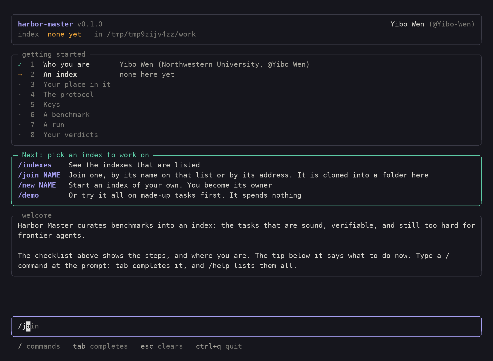
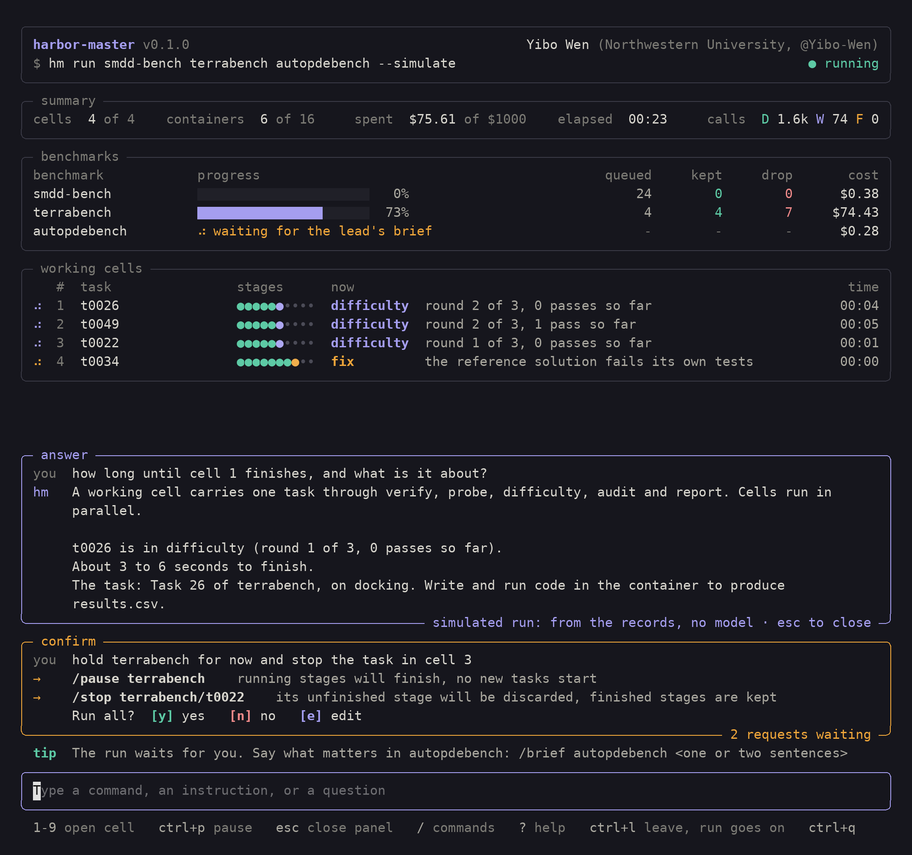
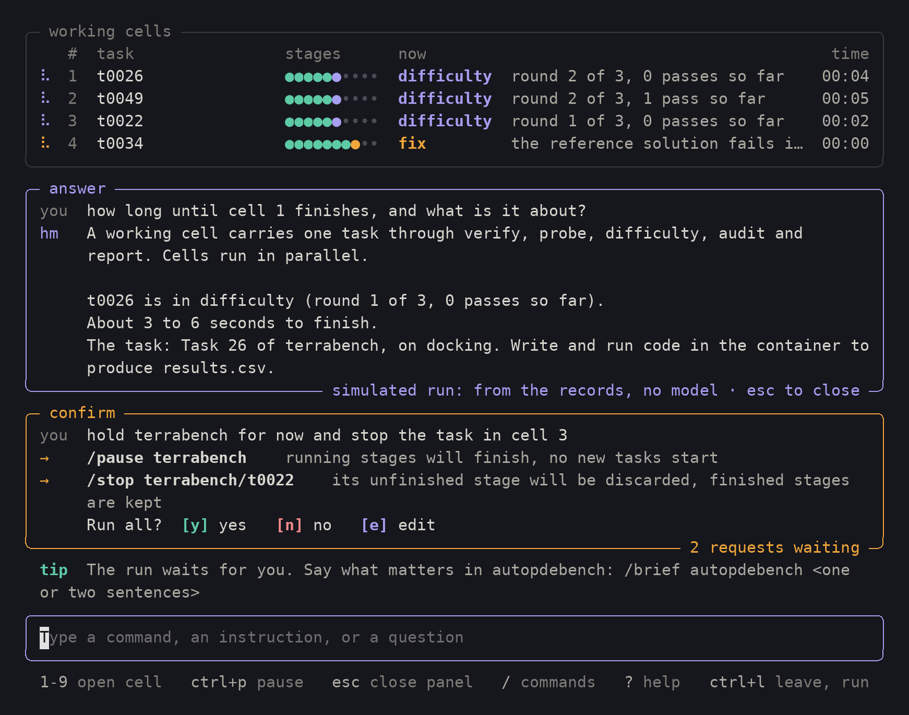
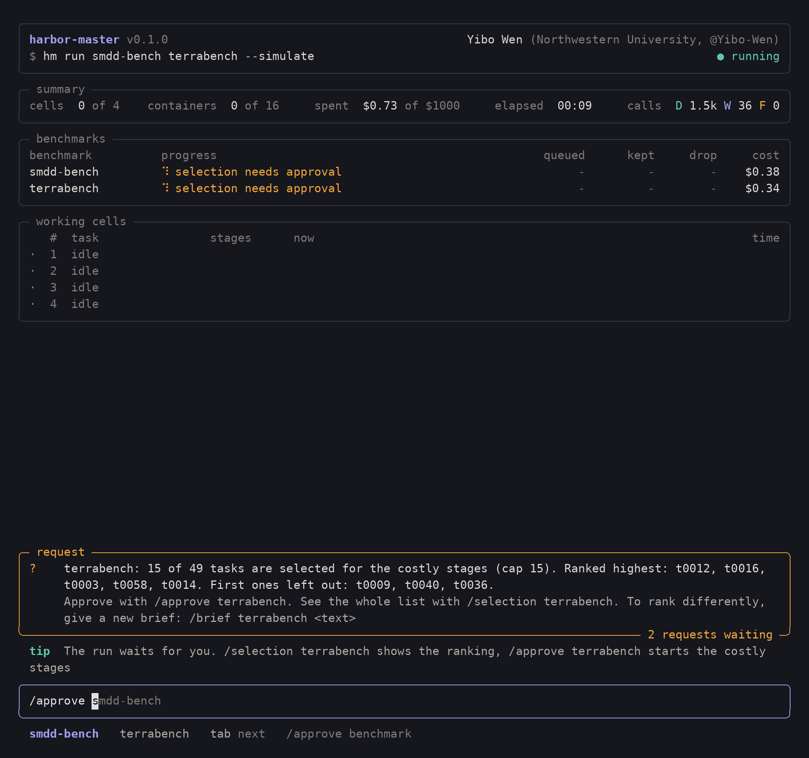
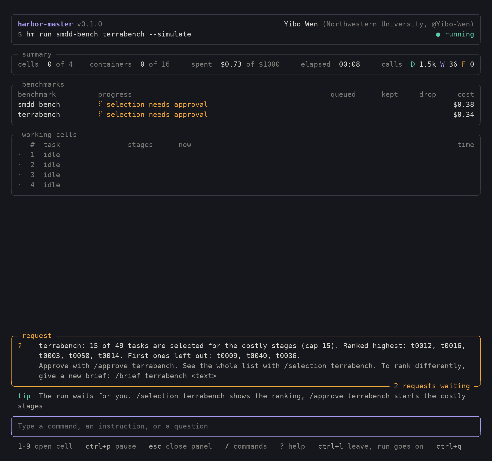
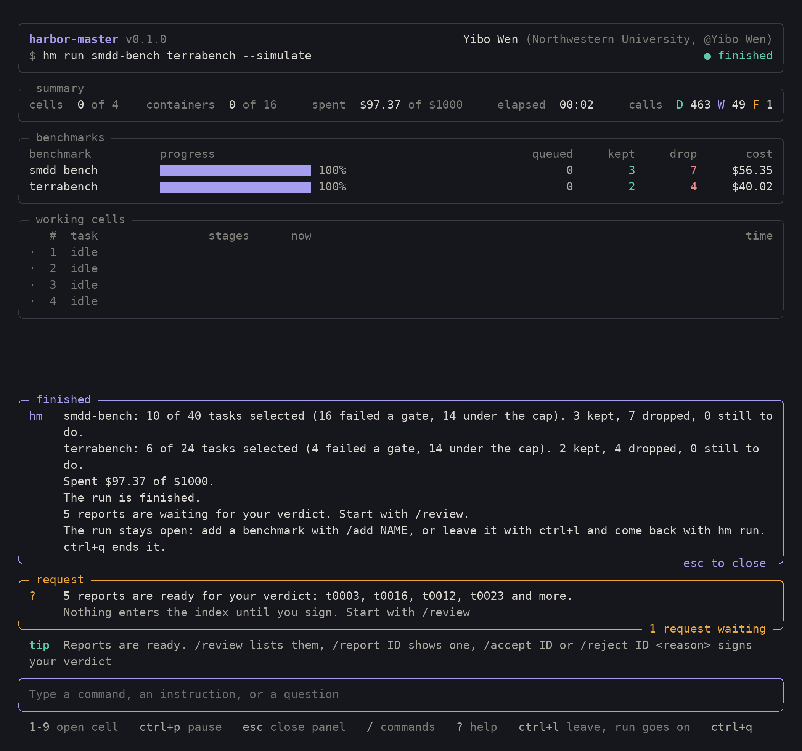

# Harbor-Master design (draft 1, 2026-11-18)

Harbor-Master takes a task or a benchmark in any format and returns a decision a human can sign: accept into an index, or drop, with the evidence. Harbor-Master holds no index of its own: each index is a repository that says what it curates and how (Section 10), and the OpenSSI Index is the first. This draft fixes the model tiers, the stages, how the parts talk to each other, the record, the config, and the CLI. Section 15 lists what is still open.

## 1. What the Harbor process costs today

Source: Harbor Adapters and Harbor-Index, arXiv 2609.04298v3, Sections 2 and 4 and Appendices D, E, H.

| Step in the paper | Who does it | What it costs |
|---|---|---|
| Adapter creation: parse to instruction / environment / tests / solution, rebuild the environment, wire the verifier | Contributor with a coding agent and the `/create-adapter` skill | Engineer time per benchmark |
| Oracle check: reference solution must pass 100% | Code | Cheap |
| Parity: original vs Harbor, 3 runs per side, means agree within SEM | Contributor | The most expensive adapter step |
| Review: bot, then 1 to 3 trained reviewers, then team lead | 5 reviewers, over 10,000 GitHub comments in total | Human time |
| Difficulty filter: 3 models x 2 harnesses x 3 trials = 18 trials per task, keep at most 6 passes | Frontier models | 6,627 tasks in, 1,311 out |
| AI audit: Gemini-3-Flash reads 2 to 4 trajectories against a two-criterion rubric | Small model | 1,311 in, 307 out |
| Human review, panel selection, trajectory-grounded audit | 14 reviewers | 307 in, 100 out |
| Audit-and-fix loop: judge labels each rollout TP/FP/TN/FN, humans repair, models re-run | Senior reviewers | 100 in, 82 out |

Three things stand out. The frontier trials are spent before any audit, so broken tasks consume most of them (about one third of the hardest candidates were broken). Humans do the repair. And it ran once. Harbor-Master reorders the work so that cheap checks come first, agents do the repair, and nothing is ever run twice.

## 2. Three model tiers

| Tier | Default model | Does | Never does |
|---|---|---|---|
| D, decision | `typesafe/jev-1.14` through OpenRouter | Every gate and routing choice: a typed value with a calibrated probability | Write prose or code (it cannot) |
| W, worker | `claude-sonnet-5-5`, headless Claude Agent SDK sessions | Build adapters, repair tasks, audit trajectories, write the report | Final judgement on a contested task |
| F, frontier | `claude-opus-5-5` | Second judge on contested audits, repair after W has failed twice, unblocking a stuck cell | Routine work |

Frontier models also appear as the *subjects* of the difficulty filter (Section 4, stage 5). That is a separate budget line from tier F.

The rule that keeps tier F rare: a stage calls the next tier up only on a recorded trigger, and each trigger is one of low decision confidence, disagreement between two checks, or a retry limit reached. The expected share of tasks reaching tier F is a number the system reports for every run.

## 3. Intercom: typed records, no agent chat

Agents never message each other. Each stage reads a typed record and writes a typed record to the cell's blackboard, plus pointers to artifacts on disk (logs, trajectories, diffs). The Harbor-Master scheduler is ordinary code running a state machine over those records.

- A tier D call is a schema (enum, bool, or bounded number, at most 255 choices) plus the text it should read. It returns the value and a probability. Reasons are enum codes, because tier D cannot write text.
- If the probability is under the stage's threshold, the same schema goes to tier W, which also returns a written rationale. If W is unsure, the item goes to tier F or the human queue, depending on the stage.
- Tier W and F agents end by writing one JSON object that validates against the stage schema. Free text lives only in a `rationale` field and in artifacts.

This makes every hand-off cacheable, comparable across tiers, and checkable by a third party.

## 4. Stages

A submission is anything: a Harbor task directory, a Harbor dataset, a git repository, a Hugging Face dataset, or a single task with a paper link.

| # | Stage | Runs on | What it decides or produces | Leaves when |
|---|---|---|---|---|
| 0 | Intake | Code | Detects the format, fetches, computes content digests, groups tasks into working cells | Always |
| 1 | Triage | D, then W on low confidence | The admission gates below, plus the field label | Any gate fails: dropped with a reason code |
| 2 | Adapt | The run itself, at its start: W with the `adapt/write-adapter` skill, F after two failed rounds, a person only after that. Once per benchmark. Skipped for Harbor-format input | An adapter in the index's repository, in Harbor's adapter layout, locked, and the Harbor tasks it writes | The owner abandons it when the models cannot make it pass |
| 3 | Verify | Code, W for repairs | Image builds, oracle passes, no-op fails, verifier is deterministic over two runs, no answer files in the agent image, verifier isolated, `harbor adapter review` passes. Sampled parity on a small parity set, run with the worker tier's model so that there is no separate setting, only when the original harness runs | Still failing after the retry limit |
| 4 | Probe | Code and W | Verifier stress test before any frontier trial (Section 5) | Verifier accepts a wrong solution or rejects a right one, and repair fails |
| 5 | Difficulty | Evaluation suite | 2 frontier models x native harness x 3 trials, in rounds, with early stop: Fable on Claude Code, and GPT-6 Astra on Codex. Each trial runs for at most 4 hours. Keep if at most 40% pass | More than 40% pass |
| 6 | Audit | W; F on unsure, on disagreement, and on a random sample | Reads 2 to 4 trajectories against the Harbor-Index rubric (test-instruction alignment, essential difficulty). Labels each rollout TP, FP, TN, FN and attributes failure to task design, agent weakness, or infrastructure | Broken and not repairable |
| 7 | Fix loop | W; F after two failed rounds | Repairs the task, then returns to stage 3. Only trials invalidated by the change are re-run | Round limit reached, or the task became easy |
| 8 | Report | W | One report per cell: task card, evidence, upstream diffs, cost, recommendation | Always |
| 9 | Human verdict | A person | Accept, reject, or send back, with a reason. Signed and credited in the ledger. The session tells a listed reviewer when reports are ready and what each one found, and the reviewer signs there or later with `hm review` | Accepted tasks enter the next index version |

**Ranking.** Scoring each task on a short scale puts most tasks on the same few values, so the rank comes from comparisons, not scores.

1. *The lead's brief.* When a benchmark is submitted, `hm brief` asks its field lead for a few sentences on what counts as important in this field and in this benchmark, and optionally for a handful of example tasks marked more or less important. The brief is stored as a `brief` event, credited to the lead. Editing it re-runs the ranking only.
2. *A score for every task.* Tier D (Jev) reads the brief and a short card for the task (its summary, field, keywords, and the start of its instruction) and places it on a five-level scale. Jev returns the position weighted by its probabilities, so scores are continuous: on the 70 tasks of Terminal-Bench-Science, 59 distinct values. This is one request per task.
3. *Pairwise comparisons near the top.* Only the order around the cut has to be exact. So the best `pool_factor` times the cap, by score, are compared in pairs: tier D is shown the brief and two cards and returns the probability that the first matters more. Each pair is asked in both orders and averaged, which cancels position bias. Each task meets about 12 others, in rounds that pair tasks of similar rating, and a Bradley-Terry model turns the results into a rating. Tasks outside the pool keep their order by score, below it.
4. *Extra comparisons at the cut.* Tasks whose rating interval straddles the cut line get more comparisons until the order there is stable or a call limit is reached. Not built yet.
5. *The lead signs off the selection.* Before any trial is spent, the lead is shown how many tasks are selected, the ones ranked highest, and the first ones left out, and can open the whole list. The lead either approves, which is signed in the ledger, or gives a new brief, which ranks again and asks again. An approved selection is not asked for twice. `require_signoff = false` skips this step for unattended runs.

What it costs. Measured on the 70 tasks of Terminal-Bench-Science, with a cap of 18: 468 requests, $0.023, 11 seconds. Comparing every task in pairs with full task descriptions, as the first version did, would have been about 840 requests and about $0.10. The saving grows with the benchmark, because the pool that is compared in pairs depends on the cap and not on the benchmark's size: for 1,000 tasks, about 1,000 scores and under 900 comparisons, against about 12,000 comparisons before. Requests run 16 at a time. It never escalates to tier W or F. If the lead marked examples, the share of example pairs that tier D orders the same way is reported, and a low share is flagged to the lead before any task is selected.

**The index cap.** One benchmark may have at most `max_per_benchmark` tasks in the index, 8 by default, so that no single benchmark dominates it. The cap applies at the verdict, not earlier: more than 8 tasks of a benchmark may pass every stage and get a report. When a reviewer accepts a task and the benchmark is already full, the task is not accepted. The reviewer is shown the tasks that are in and asked which one this task replaces. Replacing signs two verdicts together, `replaced` on the old task and `accept` on the new one, so the count never goes over. The reviewer can also reject the new task, or leave it waiting. `hm ledger verify` fails a ledger in which a benchmark is over the cap.

**Admission gates.** Triage keeps a task only if all of these hold. Each failure is recorded with its own reason code.

| Gate | Keeps | Drops | Settled by |
|---|---|---|---|
| Format | Tasks where an agent executes work: writes and runs code, uses tools, produces an artifact | Multiple choice, question answering, short-answer recall, anything graded on one typed reply | Tier D |
| Reference solution | Tasks that ship a runnable reference solution | Tasks with only an answer string, or no solution | Code checks that it exists; stage 3 checks that it passes |
| Verifier | A programmatic verifier with a deterministic result | LLM-judged, rubric-graded, human-graded, or no verifier | Tier D, then stage 3 confirms determinism |
| Verifier cost | Verification that finishes within `max_verifier_seconds` on CPU, with no paid API and no GPU | Slow or costly verification | Tier D estimates; stage 3 measures and drops on a miss |
| Recency | Released after the cutoff date | Older | Code |
| Duplicate | Not already in the ledger | Same task, or a trivial variant | Code for exact matches, tier D for near matches |
| License | Allows use for evaluation | Does not | Tier D |

Where a benchmark mixes formats, the gates apply per task, so its executable tasks stay and its multiple-choice tasks go.

**Selection cap.** A benchmark does not send all its tasks through the costly stages. After triage, the tasks that passed are ranked by importance, and only the top `min(top_k, max_fraction x N)` continue, where N is the number of tasks in the benchmark. So no benchmark sends more than `top_k` tasks, and a small one sends at most that fraction of itself. With the defaults below, a 1,000-task benchmark sends 24 tasks, Terminal-Bench-Science with 70 sends 18, and a 60-task benchmark sends 15. Importance in the field is not a gate: no task is dropped for it. It only orders the tasks inside a benchmark, as described under Ranking below. Selection goes round-robin over the benchmark's sub-areas in rank order, so the cap does not fill with near-identical tasks. Tasks below the cut are recorded as `not_selected`, not dropped, and a later run with a larger cap picks them up without repeating anything. A single submitted task is always selected.

Recency and exact duplicates are settled by code (dates from git or arXiv, digest match). Tier D only handles the judgement calls: is a near-duplicate found by embedding search the same task, a variant, or distinct.

Early stop in stage 5, with the default of 6 trials and a 40% threshold: a task needs at most 2 passes to be kept. The trials run in rounds of one per model. Drop once 3 trials have passed, keep once 4 have failed. A task both models solve is dropped after 2 rounds (4 trials), and one neither solves is kept after 2 rounds.

## 5. Where this goes beyond the paper

1. **Verifier probes before frontier trials.** For each task, a worker writes a few mutants of the reference solution: some wrong in a way that matters scientifically (wrong unit, wrong sign, off-by-one in a grid, a plausible but incorrect method), some right but different in form (reordered columns, extra precision, another valid algorithm). The verifier must reject the first group and accept the second. A cheap exploit agent also tries to pass without solving: reading answer files, querying the upstream dataset, overwriting the judge. This catches false positives and false negatives for the price of a few verifier runs, where the paper found them only after 18 frontier trials and human reading.
2. **Calibrated escalation as the self-improvement mechanism.** Every tier D and tier W decision is stored with its probability. Every later overturn (by a higher tier, a human, or a new model) is a label. Per stage, the escalation threshold is refit on those labels to hold a target error rate, and overturned cases join the in-context calibration set the auditor reads. The claim is measurable: escalation rate and overturn rate per stage, per index version. This replaces the guessed sentence in the paper's introduction.
3. **Sequential difficulty filter.** Early stopping, plus reuse of any valid trial already in the ledger for the same task digest, model, and harness version.
4. **Content-addressed record.** A repair changes the digest of what it touched, so only the stages that depend on that digest re-run. A new model release adds trials for the kept tasks only.
5. **Credited human judgement.** A verdict carries the reviewer's identity and reason, is never asked for twice on the same digest, and is printed on the task card in the index.

## 6. Working cells and parallelism

Work happens at two levels, and only the second one is parallel across tasks.

**Benchmark level, once per benchmark.** Intake, benchmark triage, the adapter, the base Docker image, and the sampled parity run are shared by every task in the benchmark. One worker agent does this once. Its outputs (adapter code, image digest, benchmark card) are cached by digest, so a second run or a second person never repeats it. A single submitted task skips straight to the task level.

**Task level, one working cell per task in flight.** A cell is a slot that takes one task from the queue and carries it through verify, probe, difficulty, audit, and fix. `cells = 4` means four tasks are in flight at once. When a cell finishes a task, it pulls the next one, from any benchmark that is ready. Cells share nothing except the read-only image and the ledger, so they need no coordination.

Inside one cell:

```
 cell 3   task smdd-bench/t0412
 ├─ verify      code        oracle, no-op, determinism           containers: 2 at once
 ├─ probe       1 worker    writes mutants, then code runs them  containers: up to 4
 ├─ difficulty  code        rounds of one trial per suite model  containers: 2 at once
 ├─ audit       1 worker    reads trajectories, writes verdict   (tier F only on trigger)
 └─ fix         1 worker    repairs, returns to verify
```

A cell holds at most one agent session at a time. It is not a team of agents: the stages depend on each other, so extra agents would wait. The speed-up inside a cell comes from running containers concurrently where runs are independent: the mutants in the probe, and the suite models in the difficulty filter. The difficulty filter runs in rounds, one trial per suite model per round, and applies the stop rule between rounds, so it keeps early stopping and still halves the wall time.

Tier D triage is not cell work. Calls take well under a second, so a whole benchmark is triaged in one batched pass before any cell starts, and tasks that fail a gate never occupy a cell.

**What limits throughput.** Three global limits, all in the config: `cells` (agent sessions), `max_containers` (CPU and memory on the host), and a rate limit per model provider. The scheduler is one asyncio process with a semaphore for each. To scale past one machine, run `hm run` on more machines against the same ledger: cells are stateless, and the claim records below keep two machines off the same task. Moving `sandbox` from `docker` to a cloud backend raises `max_containers` without other changes.

## 7. Records

Nothing goes to Harbor during curation. Three stores hold the work until the index is final.

| Store | Holds | Why there |
|---|---|---|
| Task store (a Hugging Face dataset repository or a folder, addressed by digest) | The accepted tasks, each as one archive at the version that was accepted | Too large for git, and what a later benchmark run needs. Section 8 |
| The run folder on each machine (`.hm/runs/`) | Trajectories, verifier output, logs | Evidence that stays where it was made. Not shared: Section 8 says what that gives up |
| Ledger (git) | Small typed events: who ran or decided what, on which digest, with what result and cost | Auditable history. Private until release, then made public with its full history |

A local SQLite index is rebuilt from the ledger for queries. It is never the source of truth.

**Release is the only step that touches Harbor.** Once the index is complete and its tasks are selected, `hm publish` sends the selected tasks to the Harbor registry, optionally uploads their trials to the Harbor Hub, and writes the Harbor names into the ledger. Dropped tasks and their trials are never published. Because tasks are in Harbor format and digests are computed the Harbor way from the start, publishing changes no ID and no digest.

### IDs

- **Benchmark ID**: the short `id` from `benchmarks.toml`, such as `tb-science`. It has no prefix. The pinned version and commit are recorded with the submission. A name in the Harbor registry is given only at release.
- **Task ID**: `<benchmark ID>/<task name>`, for example `tb-science/protein-active-learning`. It is stable for the life of the task.
- **Revision**: the content digest of the task directory, computed locally with Harbor's algorithm. A repair keeps the task ID and produces a new digest. Every ledger event names both, so results are never mixed across revisions.
- **Index ID**: assigned at acceptance, `ossi-chem-0031`, so the index can cite a task without depending on where it came from.

A single submitted task gets a benchmark of its own, named after the task.

### Events

One event schema covers curation and later benchmarking. Every event has `id`, `time`, `task_id`, `digest`, `runner` (the GitHub handle of who executed it, and so who contributed the tokens and compute), and `protocol` (the config hash).

| Event | Extra fields | Written when |
|---|---|---|
| `submission` | source, and every task of the benchmark with its digest and field, in one record | Intake |
| `decision` | stage, gate, tier, model, value, probability, outcome, reason, skill. The admission gates of a task are one record. The ranking and selection of a benchmark are one record | Any gate |
| `trial` | purpose (`oracle`, `noop`, `probe`, `difficulty`, `parity`, `benchmark`), agent, the pinned version and the version that actually ran, model, reasoning effort, trial index, reward, pass, tokens in and out, cost in dollars, container seconds, artifact digest and location | Any run of an agent or the verifier on a task |
| `repair` | old digest, new digest, diff digest, what was wrong | Fix loop |
| `report` | report digest and location, recommendation | End of curation |
| `verdict` | reviewer, accept / drop / send back, reason code, free-text reason | Human review |
| `claim` | task IDs, expiry, or `released` | After selection, and again when the run ends |
| `brief` | benchmark, the lead's text, example tasks, version | A field lead states what is important |
| `roster` | agent, version, model, settings, index version, trials per task | Registering an agent configuration for benchmarking |
| `usage` | rows of stage, tier, model, calls, tokens and cost: what the model tiers were called for since the last such record of the run | After a benchmark's shared phase, after each task, and when the run ends |
| `skip` | a one-word reason and the full one | A run leaves a benchmark out: it could not be fetched, has no adapter, was abandoned, got no brief, its selection was not approved, someone else is screening it, or it failed with an error |

A frontier run during curation and a run by a new agent six months later are the same `trial` event with a different `purpose`. The difficulty filter and the leaderboard therefore read one table, and a benchmarking run by anyone also counts as evidence when the next release decides which tasks to retire.

### Skills: what each agent is told

Every prompt, question, and criterion an agent reads is a file, grouped by stage. Code holds the rules, such as which answers pass a gate. Skills hold the wording.

The curation skills (the first five rows below) decide what gets into an index, so they belong to the index: each index has its own copies under `skills/` in its repository, and the files under `src/harbor_master/skills/` are the templates those copies start from. The session skills (the last row) only read what is typed on the run screen. They change no result, so they stay in the tool, the same for every index, and are in no protocol.

| Skill | Read by | For |
|---|---|---|
| `triage/gates.toml` | decision tier (Jev) | The admission gates: each question, and what each answer means |
| `triage/decide.md`, `triage/confirm.md` | decision tier on a general model, worker tier | One gate, and re-deciding a gate the decision tier was unsure about |
| `rank/score.toml`, `rank/compare.toml` | decision tier | How much one task matters under the lead's brief, and which of two matters more |
| `adapt/write-adapter.md` | worker tier | The adapter that turns a benchmark in another format into Harbor tasks |
| `probe/write-mutants.md` | worker tier | Variants of the reference solution that test the verifier |
| `audit/rubric.md` | worker tier | The task-quality rubric. Written, not used yet |
| `session/interpret.toml`, `session/answer.md` | decision tier, chat tier | Reading a typed line, and answering a question from the records |

A `.md` skill has a system part and a prompt part with `$name` placeholders that code fills in. A `.toml` skill is data for the decision model. Skills for stages that are not built yet (repair, report, adapter) get a file when the stage is built, including any taken over from Harbor's `/create-adapter`.

**Versions.** A skill's version is a short hash of its file. Every ledger record made with a skill names it and its version, for example `triage/gates@dee91cd340`. So for any decision that a higher tier or a person later overturned, the exact wording that produced it is known.

**Why this is the handle for self-improvement.** With versions on every record, two versions of a skill can be compared on the same tasks by their overturn rates, escalation rates, and cost. An agent that proposes an edit to a skill file, and keeps it only when those measures improve on fresh tasks, is the recursive step. That loop is future work. The organization that makes it possible is in place: one file per job, a version on every record, and the labels in the ledger.

### Credit

Credit is not stored separately. It is computed from the ledger: per person, the tokens and dollars contributed, container hours, trials run, tasks submitted, repairs made, and verdicts signed. `hm credits` prints it, each index release ships it as `CREDITS.md`, and each task card lists who submitted, repaired, ran, and judged that task.

### Never run twice

A trial slot is (task digest, agent and version, model, reasoning effort, protocol, trial index). The protocol fixes how many indices exist, so there is a known, finite set of slots.

- **Before spending**: `hm run` and `hm eval` sync the ledger and refuse any slot that is filled, printing the existing result and who ran it. Decisions and verdicts work the same way, keyed by (digest, stage, protocol) and (digest, reviewer).
- **At merge**: contributions reach the ledger as pull requests. CI runs `hm ledger verify` and rejects a push that fills a slot already on `main`, breaks a hash chain, fails the schema, or names a digest missing from the task store. If two runners race, the first merged wins and the second is told which records were rejected.
- **Claims** make races rare: a runner pushes a claim with an expiry before the costly stages, and others skip claimed slots.
- **More samples** need a new protocol version that adds indices. Nobody adds trials ad hoc.
- **Agent versions are pinned and checked.** Both suite agents are pinned to an exact build, because a different build of an agent CLI sends a different request and can score differently. The slot is keyed by the pin. Each trial also records the version the agent itself reported, and `hm ledger verify` rejects a trial whose two versions differ.

### Two people at once

Three rules keep contributors out of each other's way.

- **Fields.** Each contributor has `fields` in `contributors.toml`, written like the benchmarks' own task fields, for example `life-sciences`. A real run covers only the tasks of a benchmark that fall in the runner's fields. The rest are left for others, and a benchmark with no task in the runner's fields is skipped. The owner may curate every field, as may anyone with `"*"`. A listed person with no fields cannot curate. The same rule decides whose verdict on a task is accepted.
- **Claims.** Before any work, a run pulls the shared ledger, writes a `claim` event naming the tasks it is about to work on, with an expiry (`claim_hours`, 12 by default), and pushes it. `hm claims` lists who holds what.
- **The push is the lock.** Git refuses a push when someone else pushed first. The run that is refused pulls, sees the other person's claim, releases whatever they both claimed, and keeps only the rest. So when two people claim at the same moment, exactly one of them gets each task.
- **Screening is locked the same way.** Screening, ranking, and selecting a benchmark is held by one person at a time, so that two people do not write the same decisions twice. The run pulls first, so decisions already made are reused.
- **A rerun is rejected.** A task someone else holds is left to them, and the run says who. A task that already has an outcome under this protocol (dropped, report ready, accepted, rejected) is not run again by anyone, and the run says so. Changing the protocol is the way to run a task again.
- **A task that did not finish is let go.** A claim is released the moment its task ends, whatever the ending. A finished task is then protected by its records. A task that failed, hit an error, or was stopped with `/stop` has no outcome, so it is free for anyone, including a later run by the same person. A run that crashes cannot release, and its claims expire.
- **Reuse.** Whatever was already decided or run is reused, not repeated.

**Setting it up.** A workspace is a clone of the index's repository (Section 10). The owner shares a new index with `hm index connect URL`, and everyone else gets it with `hm join URL`. From then on every run pulls before it claims and pushes as each task ends, and `hm sync` does both by hand, refusing to push a ledger that fails `hm ledger verify`. A run commits only its own records under `ledger/`. An index that is not connected works alone, with the same rules applied to its own ledger.

Before release the shared ledger is a private repository whose collaborators are the listed contributors, and they push to it directly. The pull-request flow with a check on each merge, described under Benchmarking, is for after release, when outsiders contribute. A claim needs the direct push to work as a lock.

### Concurrent writers

No two runners write the same file. Each run appends to its own shard, `ledger/<benchmark>/<runner>-<run id>.jsonl`, with its own hash chain, so git never sees a textual conflict. `hm sync` pulls, rebases, and opens or updates the pull request. The state of a task is computed by folding its events:

- Automated decisions for the same digest and stage: the higher tier wins, then the later one. The losing record stays as an overturn label for calibration.
- Human verdicts are never overwritten. Two that disagree put the task in a `contested` state for the field lead, and both reviewers stay credited.

### What is not solved by this

- **Trust.** A contributor could submit trials that never ran. The artifact digest makes a record checkable, and a sampled re-run can catch fabrication, but neither is proof. Accepting records only from signed commits by known runners is the simple first rule.
- **Contamination.** Public trajectories of index tasks contain solution attempts, and public tasks contain reference solutions. Nothing is public before release. At release, tasks can be published while trials and solutions stay private.
- **Licenses.** Some benchmarks do not allow redistribution. Those can be recorded in the ledger by digest and built from source by the adapter, and are left out of `hm publish`.

## 8. Identity, local files, and what is uploaded

### Identity

`hm init` runs once and asks for a name, an affiliation, an email, and a GitHub handle, all required. It writes `~/.config/harbor-master/identity.toml` and creates a signing key. Every other command refuses to run without it.

A person is identified by their GitHub handle and signing key, never by their name. Every event carries the handle and is signed with the key, and credit is grouped by handle. The name and affiliation are for display only, so two people with the same name stay separate, and a name can change without losing past credit. Credits, task cards, and the leaderboard show `Name (Affiliation, @handle)`.

The email goes into a private contributors file by default, because the ledger becomes public, and a contributor can opt in to showing it.

### What a run leaves on disk

Little, and all of it readable. The rule is that nothing is stored twice, and nothing is kept that a record already says.

```
~/.config/harbor-master/                   your identity and signing key
<workspace>/                               a clone of the index's repository
  about.toml                               what the index is
  protocol.toml                            the curation protocol, locked
  benchmarks.toml  roster.toml             what may be curated, and which agents are benchmarked. Locked
  contributors.toml                        who may curate. Locked
  index.toml                               the accepted tasks, written from the verdicts
  reports/<benchmark>/<task>.<digest>.md   the report on each task that reached one, for the reviewer
  ledger/
    <benchmark>/<you>-<run id>.jsonl       one file per run: every record that run made
    <benchmark>/<you>-manual.jsonl         one file for what you record by hand: briefs, verdicts
    _protocol/<owner>-manual.jsonl         the protocol locks
  .hm/                                     this machine's own files. Git ignores the folder
    hm.toml                                this machine's settings
    owner                                  the owner's key, as it was when this machine joined
    tasks/registry.json                    which benchmarks are registered here
    sources/<benchmark>/                   the benchmarks, cloned at their pinned release
    store/                                 a copy of each accepted task's archive, and the ones unpacked for a benchmark run
    stats/                                 what hm stats wrote: stats.md, and tables/ with a CSV per table. stats/simulated/ for simulated runs
    simulated/                             what simulated runs recorded: its own ledger/ and index.toml. Never in the index
    runs/<run id>/
      run.json                               counts per stage, cost per tier, calls
      tasks.jsonl                            one line per task: its status and every stage's result
      trials/<task>.<agent>.<model>.<i>.tar.gz   only agent trials, and runs that went wrong
      session.log                            only if something was typed
      requests.json                          only while something is waiting on the user
```

What keeps it small:

- **No copy of the ledger in the run folder.** A run's records are in its ledger file and nowhere else.
- **One file for all tasks, not a folder each.** `tasks.jsonl` has one line per task. A report file exists only for a task that reached a report.
- **Harbor's output is kept only when it is evidence.** An agent trial is kept, as one archive: trajectory, verifier output, result. So is any run that went wrong: a reference solution that failed, a no-op that passed, a mutant that exposed the verifier, an infrastructure error. A reference solution that passed and a no-op that failed leave only their ledger record. Files over 5 MB are listed in the archive, not stored, and Harbor's working folder is removed either way.
- **One record per task for the admission gates**, holding every gate's answer and probability, not one record per gate. A gate that went up a tier adds two short records, the unsure answer and the one that replaced it, because that pair is what thresholds are tuned on.
- **One record per benchmark** for what was submitted, and one for the ranking and selection, not one per task.
- **No empty fields.** A record leaves out anything empty or zero. Trial records are the exception: they keep every field, so that all trials have one shape.
- **One file per person for records made by hand**, however many briefs or verdicts.

Measured. The first real run stored 97 MB in 142 files for three tasks, and 96 MB of it was two copies of one output file from reference-solution runs that had passed. Under these rules the same run leaves about 100 KB. A simulated benchmark of 1,000 tasks with 24 selected leaves a run folder of 64 KB in 8 files, and 1.5 MB of ledger in 1,814 records, most of it the admission record of each task. Before these rules the same simulated benchmark took 7.2 MB of ledger and 316 files in the run folder.

### API keys

Keys never enter the config, the ledger, or anything uploaded, and git never sees them.

- The repository ships `secrets.env.example`, which lists every variable with a comment on what it is for: an API key or a subscription sign-in for Claude and for Codex, the OpenRouter key for Jev, and the Hugging Face token. `hm keys init` copies it to `secrets.env` in the repository folder, with owner-only permissions, to be filled in by hand. A variable left empty counts as not set.
- `hm` reads keys from environment variables first (the Claude and Codex credentials below, `OPENROUTER_API_KEY` for Jev, `HF_TOKEN`), then from `secrets.env`. It looks for that file from the current folder upward, then in the repository folder, so it is found from any workspace. `hm keys set NAME` writes to it.
- Claude and Codex each take one of two credentials: an API key, billed per token, or a sign-in to a subscription. For Claude these are `ANTHROPIC_API_KEY` and `CLAUDE_CODE_OAUTH_TOKEN` (from `claude setup-token`). For Codex they are `OPENAI_API_KEY` and `CODEX_AUTH_JSON_PATH`, the path of the file that `codex login` writes; the path is stored, never the file's contents, and it counts as set only while the file exists. When both are set, the sign-in is used, for the curation agents and for agent trials alike.
- `secrets.env` and `.env` are listed in `.gitignore`. Before writing the file, `hm` checks that its folder's `.gitignore` names it, and adds the line if it is missing. The protection is the ignore rule, so the file must keep that name.
- Neither settings file holds a key. `protocol.toml` names providers and models, never credentials.
- `hm doctor` lists which keys are present and which stages and benchmark slots this machine can therefore run. `hm contribute` uses the same check to skip slots it has no key for.
- A key is passed to an agent's container only for the trial that needs it, through Harbor's own mechanism. The agent can therefore see its own key, so it can end up in a trajectory. `hm sync` scrubs trajectories and logs for every loaded key value and for common key patterns, and refuses to upload a file that still matches.
- Each runner uses their own keys. Nothing is pooled, and the ledger records tokens and cost, not which key paid.

### Where each thing goes

Two places are shared, and nothing else is.

| What | Goes to | Why there |
|---|---|---|
| The index's definition, its adapters, the ledger, the reports, `index.toml` | The index's repository, through `hm sync` and every run | Small text, signed or checked against a signed record, and needed by everyone |
| The accepted tasks, at the version that was accepted | The index's task store | Too large for a git repository, and the only thing a later benchmark run needs besides the ledger |
| Trial archives, mutants, `run.json`, `tasks.jsonl`, `session.log`, statistics | Nowhere: they stay in `.hm/` on the machine that made them | The ledger already holds every result. See below for what that gives up |
| Identity, API keys | Nowhere | Local only |

### The task store

A later benchmark run must run exactly the task that was accepted. Three things make a copy necessary:

- **Size.** Tasks are too large for git. In Terminal-Bench-Science 0.1.0 the 70 tasks take 1.1 GB, the median task is 1.6 MB, 20 are over 10 MB, and the largest is 196 MB.
- **Repairs.** A repaired task has a new digest and exists nowhere but on the machine that repaired it. The benchmark's source and the adapter give only the version before.
- **The source may go.** A pinned commit does not protect against a repository that is deleted or rewritten.

So each accepted task is kept as one archive, named by benchmark, task and digest: `tasks/<benchmark>/<task>.<digest>.tar.gz`. Only accepted tasks are kept, at most `max_per_benchmark` per benchmark. Every other converted task can be written again by the locked adapter, with the same digest.

- **Where.** `tasks` in the index's `about.toml` names the store: a Hugging Face dataset repository, written `org/name`, or a folder, such as a shared drive. A copy is always kept on the machine, under `.hm/store/`. With nothing named, that copy is the only one.
- **When.** Accepting a task puts its accepted version in the store, beside the run, and the recent outcomes say how it went. It never holds a verdict back. If the files on the machine are not the accepted version, it says so and keeps nothing.
- **`hm tasks`** lists each accepted task and where a copy is. `hm tasks push` puts in whatever this machine has and the store lacks. `hm tasks pull` brings every accepted task onto this machine.
- **`hm eval` runs the accepted version or nothing.** For each accepted task it uses the files of the benchmark on the machine if their digest is the accepted one. Otherwise it takes the archive from the store, unpacks it, and checks the digest. If there is no copy, or the copy does not match, it refuses: a result on another version would be a result for a different task.
- **A copy that does not match its digest is thrown away**, archive and files, and reported.
- **Hugging Face** needs the `huggingface_hub` package (`uv tool install --editable '.[hf]'`) and a token with write access to that one repository, set with `hm keys set HF_TOKEN`. The repository is private until release. Written, and never run against Hugging Face: only the folder store is tested.
- **At release**, `hm publish` sends the accepted tasks to the Harbor Hub, where anyone can run them with `harbor run -d`. Not built.
- **A benchmark whose licence forbids redistribution** should not be copied into a store that will be public. Nothing checks that yet.

### Reports

A reviewer signs a verdict from the report, so the report must reach the reviewer's machine. It is written into the index's repository, as `reports/<benchmark>/<task>.<digest>.md`, and committed with the ledger records of the run that wrote it. The record of a report holds a checksum of the file, and `hm ledger verify` reports a report that was changed afterwards. A simulated run writes its reports under `.hm/simulated/`, with its other records.

### What is not shared, and what that gives up

Trial archives (the trajectory and the verifier's output of each agent trial), the mutants of the probe, and each run's own summary files stay on the machine that made them.

- **Nothing the system does needs them elsewhere.** The ledger records each trial's result, tokens, cost, time and agent version. The index, the leaderboard and the statistics are computed from that. The audit reads trajectories on the machine where the trials ran, while the run is going.
- **What is given up:** a trial's record is a signed statement that the trial happened and how it went. Nobody else can open the trajectory to check it, and it is gone when that machine's run folder is deleted. A reviewer on another machine reads the report, not the trajectories.
- **No private store for mutants and repair diffs.** An earlier draft kept them apart because they reveal solutions. A Harbor task ships its reference solution in `solution/` already, so there is nothing more to protect. A repair's diff is the difference between the stored task and the one the source gives.
- **If outside-checkable evidence is wanted later**, the trial archives of the accepted tasks alone are few, and can go into the task store beside the tasks.

## 9. Benchmarking on the index

Once the index exists, the same tool runs agents on it. Trials are `trial` events with purpose `benchmark` (Section 7), so the slot and duplicate rules apply unchanged.

**One kind of trace.** A benchmark trial and a difficulty trial are made by the same function, `stages.trial`, so they cannot drift apart. Each leaves:

- one `trial` record in the ledger with the same fields: purpose, agent, pinned version, the version that ran, model, reasoning effort, trial index, pass, reward, tokens in and out, cost, agent seconds, verifier seconds, Harbor's task checksum, where the files are, and any infrastructure error;
- one archive under `runs/<run id>/trials/`: the trajectory, the verifier's output, and the result;
- one entry in the task's line of `tasks.jsonl`.

A test checks that the two records have exactly the same set of fields. The leaderboard reads both kinds as one table, grouped by agent, version, model, and effort.

**The roster.** A `roster` event registers an agent configuration (agent, version, model, settings) for an index version, with the number of trials per task. The roster times the index tasks defines every slot that should exist. Anyone can propose a roster entry, and a maintainer merges it.

**Directed mode.** Pick the agent and the tasks:

```
hm eval --agent claude-code --model claude-fable-5-1 --index v1.0 --field chemistry
hm eval --agent codex --model gpt-6-astra --tasks ossi-chem-0031,ossi-phys-0007
```

Filled slots are refused, with the existing result shown. An agent configuration not on the roster runs locally and is marked `unlisted`: its records can be submitted, and they count once the roster entry is merged.

**Auto mode.** Contribute whatever is missing:

```
hm todo                         unfilled slots, grouped by roster entry and field
hm contribute --budget 50       claim open slots, run them, submit the records
```

`hm contribute` syncs, lists open slots, keeps the ones this machine can run (the agents installed, the API keys present, enough memory for the task), and orders them so that the least-covered tasks go first. It claims a batch, runs it, submits the records, and repeats until the budget in dollars or the time limit is spent. The same mode works during curation, where open slots are difficulty trials and audits.

**Reading results.** The leaderboard is not a file anyone edits. It is computed from the ledger: pass rates per roster entry, with trial counts and who ran them. `hm leaderboard` computes it locally from a synced ledger. On every merge to the ledger's `main` branch, CI recomputes it and commits `leaderboard.json` and `LEADERBOARD.md` to the ledger repository, which a public page can read. The only way to change the leaderboard is to get trial records merged, and a hand edit to those two files is overwritten by the next CI run.

**Who can update what.** The ledger is a GitHub repository. Nobody but the owner pushes to `main`, and the owner does so only to maintain the contributor list and the checks. The repository is private until release, so contributors are collaborators added by the owner, and `hm sync` pushes to a branch. After release it is public and outside contributors use forks. A contributor's `hm sync` pushes their shard to a branch or fork and opens a pull request. CI runs `hm ledger verify` on it: schema, hash chain, signature matching the contributor's registered key, no filled slot refilled, every digest present in the task store. Records from listed contributors merge automatically when CI passes. Anyone not on the list is rejected. Records and verdicts merge only from people on the contributor list below.

**The contributor list.** `contributors.toml`, in the index's repository, names who may submit records and sign verdicts. Each entry has a name, an affiliation, a GitHub handle, the public signing key from `hm init`, and optionally the fields the person may judge. The OpenSSI Index's list:

```toml
[[contributor]]
name = "Yibo Wen"
affiliation = "Northwestern University"
github = "Yibo-Wen"
key = "ssh-ed25519 AAAAC3NzaC1lZDI1NTE5AAAAICBW+QQkXnc0vGZclnShd6bfqXQz+X6Ktr7hARe89Kiz"
role = "owner"

[[contributor]]
name = "Chenwei Wu"
affiliation = "University of Michigan"
github = ""
key = ""

[[contributor]]
name = "Ruoxi Zhang"
affiliation = "University of Pennsylvania"
github = ""
key = ""
```

An entry with no handle or no key is listed but cannot contribute yet. `hm contributors` shows each person's status. To be able to contribute, a listed person runs `hm init` and sends the owner the public key it prints.

`hm index new` writes the list with one entry, the person who starts the index, as its owner. `hm join` brings the list with the clone, and tells a person who is not on it to send the owner their public key.

Affiliations are printed with names in `CREDITS.md`, on task cards, and on the leaderboard.

- `github` and `key` are required, and CI rejects a list in which two entries share either one. Names may repeat.
- A `verdict` event is accepted only if its signature matches the key of a listed contributor and the task's field is among that contributor's fields.
- Only the owner changes the list. Its checksum is locked with the protocol, so a copy that anyone else changed makes every run refuse, and a run never commits the file. On GitHub, branch protection and CI guard it as well: CI fails any pull request whose diff touches `contributors.toml`.
- The same rule covers `.github/` and the verification code, and CI for pull requests runs the workflow as it is on `main`, not as the pull request has it. Otherwise a pull request could switch off the check that protects the list.
- Removing a contributor stops new records and verdicts from them. Verdicts they signed while listed stay valid and credited.

## 10. Config

### The index repository

Harbor-Master is the tool, and holds no index. Each index is a git repository of its own, and that repository is everything the index is: the files that define it, and its ledger. So one tool serves many indexes, and an index can be read, cloned, and checked without the tool's repository.

| File | Says | Who changes it | How a change is caught |
|---|---|---|---|
| `about.toml` | The index's name, title, description, homepage, licence, and artifact repositories | The owner, at any time | Not locked: it changes no result |
| `protocol.toml` | The protocol: every setting that can change a result | The owner, by locking | Its hash is locked. A run with different settings is refused |
| `benchmarks.toml` | Which benchmarks may be curated, each pinned to a release | The owner, by locking | Its checksum is locked beside the protocol |
| `roster.toml` | Which agent configurations are benchmarked on the index | The owner, by locking | Its checksum is locked beside the protocol |
| `contributors.toml` | Who may curate, in which fields, and their signing keys | The owner, by locking | Its checksum is locked beside the protocol, and every record is checked against it |
| `skills/` | What the agents that curate this index are told: the adapter, the gates, the ranking, the probe, the audit | The owner, by locking | Part of the protocol hash |
| `adapters/<benchmark>/` | The code that turns a benchmark in another format into Harbor tasks | The owner, by locking | Its checksum is locked beside the protocol |
| `ledger/` | Every record | Everyone on the list, through `hm` | Signed and chained: `hm ledger verify` |
| `reports/` | The report on each task that reached one | Nobody: `hm` writes them | Each report's record holds its checksum |
| `index.toml` | The accepted tasks | Nobody: `hm` writes it from the verdicts | `hm ledger verify` |

- **Starting one.** `hm index new NAME [DIR]` writes these files from blank templates, lists the caller as the owner, and makes the folder a git repository with one commit. The owner fills in the lists, locks them with `hm protocol lock`, and shares the index with `hm index connect URL`.
- **Joining one.** `hm join URL [DIR]` clones the repository. The clone is the workspace: `hm` finds it from any folder inside it, by its `protocol.toml`. What belongs to one machine (its settings, the benchmarks it fetched, its runs) is in `.hm/` inside the clone, which git ignores.
- **Fetching.** Nothing is downloaded on each command. A run pulls the repository before it claims, as it always did for the ledger, and reads the definition from the clone. Offline, a run uses the last copy pulled, and the lock still refuses a copy that is not the locked one.
- **What a run may commit.** Only files under `ledger/`. The files that define the index are committed by two of the owner's commands and nothing else: `hm protocol lock` commits all of them with the lock that covers them, and the owner's `hm sync` commits `about.toml`. Anyone else's edit to them stays on their machine, where it makes their own runs refuse.
- **Whom a clone trusts.** Everything rests on the owner's signature: the lock is valid because the owner signed it, and the owner is whoever `contributors.toml` says. So a workspace writes down the owner's handle and key the first time it sees the index (`.hm/owner`), and refuses every command if a later copy of the list names a different owner. Trust starts from the address a person chose to join.
- **Skills.** What agents are told is part of what an index is, so the index holds it. `hm index new` copies the tool's templates of the curation skills into `skills/`, and from then on the index reads its own copies and nothing else. They are in the protocol hash, so they are locked like any setting, and git history shows what agents were told under each lock.
  - **Why not defaults in the tool.** If an index read the tool's files, a release that reworded one prompt would change the protocol of every index, and what agents were told would depend on which version each person had installed.
  - **Any wording, the same structure.** An index may reword a skill freely, for example to judge tasks outside science. It may not change what the code reads: the keys of a TOML skill, and the `$placeholders` and the two sections of a prompt. A copy that does is refused before any run, with the reason.
  - **Taking in a newer template is the owner's choice.** `hm skills` shows each skill as the same as the template, the index's own wording, or missing. `hm skills diff` shows what differs. `hm skills adopt`, owner only, copies templates in: with no name only the missing ones, with a name that one. The owner then locks.
  - **The lock needs them all.** `hm protocol lock` refuses while a skill is missing or unusable. After a lock, a clone that has lost one is refused too: it is never quietly replaced by the tool's.
- **The tool's version.** `[requires] harbor_master` in `protocol.toml` is the oldest Harbor-Master that may run the index. It is recorded in the lock, and an older tool is refused. It is not part of the protocol hash, so raising it does not start a new protocol.
- **`hm index`** prints what an index is: title, description, owner, contributors, benchmarks, accepted tasks, protocol and whether it is locked, how many skills are in its own wording, and where it is shared.

**The list of indexes.** A site that shows every index needs one more thing: where the indexes are. That is one file, `indexes.toml`, at the top of the Harbor-Master repository (`Open-SSI/harbor-master`). The file, the commands and the check are built. The site is not.

```toml
[[index]]
name = "openssi"                                     # unique. hm join openssi resolves it
url = "https://github.com/Open-SSI/openssi-index"    # an example: the repository does not exist yet
owner = "Yibo-Wen ssh-ed25519 AAAA..."               # the owner's handle and key when it was listed
listed = "2026-11-19"
```

- **It is read from the main branch, not from the installed package.** `hm indexes` and `hm join NAME` fetch the file from the repository's main branch each time, so a new entry is visible to everyone as soon as it is merged, with no release of the tool. Another list can be named with `--list` or `$HM_INDEXES`, as a file or an address, for a group that keeps its own.
- **It holds addresses and nothing else.** Title, description, owner, benchmarks, accepted tasks, contributors and the leaderboard are read from each index's own repository, which already has them in `about.toml`, `contributors.toml`, `benchmarks.toml`, `index.toml` and the ledger. Nothing is written twice, so the list cannot fall behind an index, and the file stays a few lines per index.
- **Getting listed** is a pull request that adds one entry. `hm index entry`, run in the index, prints the entry. The check on the pull request is `hm indexes --check`: it clones each address and makes sure that it is an index, that its files parse, that no name or address is listed twice, that the name is the one in its `about.toml`, that the owner on the entry is the owner in the repository, and that `hm ledger verify` passes. So the repository must be readable by anyone. The maintainers merge the entry. They decide what is listed, and nothing about what is in an index. `.github/CODEOWNERS` makes the owner the reviewer of the file.
- **Publishing is a push to the index's own repository.** Nothing is uploaded to Harbor-Master. An owner's lock or a contributor's `hm sync` changes the index, and the site shows it at its next build.
- **The owner's key on the entry** gives `hm join NAME` something to check the clone against, which a bare address does not. A repository that changed hands no longer matches its entry: the join is refused and the clone removed.
- **The site. Not built.** It is built from the list by a scheduled job in the same repository: for each entry it clones the repository, checks it as above, and writes one page per index, with the leaderboard computed from the ledger as `hm leaderboard` does. `hm indexes --check` already prints the first columns of that page: title, owner, benchmarks, accepted tasks. An index that has gone private, or fails the check, is shown as listed and not readable.

This is how Harbor's registry began. Its first form was one `registry.json` in the Harbor repository, read by the CLI from the main branch, with a pull request per dataset. In March 2026 Harbor replaced it with a hosted service, the Harbor Hub: `harbor publish` uploads an archive and writes to a database, names are `org/name`, a version is a content digest with tags, and data can be private. The file is still served, and holds 80 dataset versions and 51,625 tasks in 13.6 MB, because each entry lists every task. Ours lists only addresses, so it does not grow that way. A hosted service becomes worth building when listing must not wait for a maintainer, when a private index must be shown to some people and not others, or when the site needs search and download counts. None of that is needed for the first indexes.

### Adapters

A benchmark whose tasks are not Harbor task folders needs an adapter: code that reads the benchmark as its authors released it and writes one Harbor task per task. Its entry in `benchmarks.toml` says so with a `format` other than `harbor`.

- **It belongs to the index, and is locked.** The adapter decides what the tasks are, so everyone who curates the benchmark must run the same one. It is in the index's repository under `adapters/<benchmark>/`, its checksum is in the owner's lock, and a run with a changed or unlocked adapter is refused, like any other locked file.
- **It has Harbor's own adapter layout:** `README.md`, `adapter_metadata.json`, `parity_experiment.json`, `pyproject.toml`, and a package with `adapter.py`, `main.py` and `task-template/`. `main.py` takes Harbor's flags (`--output-dir`, `--limit`, `--overwrite`, `--task-ids`) and one more, `--source-dir`: the benchmark at its pinned release, which Harbor-Master fetches and passes in. So an adapter built here can be offered to Harbor later, and one written for Harbor can be taken in with `hm adapt ID --from PATH`.
- **A run does it by itself.** `hm run` takes any benchmark on the index's list. It fetches one that is not here yet, at its pinned commit. If the benchmark is in another format and the index has no locked adapter for it, the owner's run builds one before anything else, with no one asked:
  1. the worker model reads the benchmark's files and writes the adapter, and the checks below run;
  2. a failing adapter goes back with its failures: to the worker model once more, then to the frontier model (`[adapt] frontier_after_round`, `max_rounds`);
  3. one that passes is recorded, locked, and used at once. The lock adds this adapter's checksum to what was locked already, and nothing else;
  4. only when the models cannot make it pass is a person asked, in the run screen, for one of two things. `/recheck BENCHMARK` checks the adapter again: the person's own fix if the files changed, otherwise one more try by the frontier model. `/abandon BENCHMARK` gives the benchmark up, and that is recorded in the ledger.
  5. An abandoned benchmark is refused to everyone: the owner's later runs, other people's runs and simulated runs leave it out before fetching anything, and say who abandoned it, when and why. `hm run BENCHMARK` by name is refused outright. `hm benchmarks` marks it. Changing its files does not reopen it. Only the owner does, with `hm adapt BENCHMARK`: an adapter that passes is a later record, and the latest record of the stage decides.

  Everyone else's run uses the locked adapter as it is. Until there is one, it skips that benchmark and says so. A simulated run never builds an adapter: it uses one that is there, or skips the benchmark. With `[adapt] require_review = true`, the owner is also asked to confirm an adapter that passes, with `/lock BENCHMARK`, before it is locked. It is off by default, so that a benchmark needs no one unless something fails.
- **How a model writes it.** The session has read-only tools in the benchmark's folder, and returns `adapter.py` and the task template as text. It cannot write or run anything: Harbor-Master writes the files, and only those two kinds, into the adapter's package. The session is told to keep each task's own instruction, check and reference solution, and to invent nothing.
- **`hm adapt ID`**, owner only, does the same apart from a run, or again: for an adapter brought from elsewhere (`--from PATH`), for one written again by the models (`--rewrite`), or after an abandon.
- **The checks** need no model:
  1. the layout is complete, the entry point takes its flags, and the code imports the standard library only;
  2. it runs, and writes at least one task;
  3. every task has a `task.toml` that parses, a non-empty `instruction.md`, an `environment/Dockerfile` and a `tests/test.sh`, and the number of tasks is the one `benchmarks.toml` gives;
  4. a second run writes exactly the same tasks, by content digest;
  5. the reference solution of a few generated tasks (two by default) passes its own test through Harbor.

  One that passes leaves a `decision` record for the stage, with the adapter's digest, the number of tasks, who wrote it, the rounds and the cost.
- **Its code runs in a container:** no network, the adapter and the benchmark mounted read-only, and one folder to write to. This holds for the owner building it and for everyone who later runs it, since it is code from a repository they joined. `--no-sandbox` runs it on the machine as it is, for code one has read.
- **It holds back only its own benchmark.** An adapter that is changed, or not locked yet, stops that benchmark's tasks from being used. The other benchmarks of the index run as usual. `hm protocol` lists such adapters apart from the differences that refuse a run.
- **The same tasks for everyone.** Whoever runs the locked adapter on the pinned source gets the same tasks, so their digests, and so the ledger's records, line up. `hm submit ID` does the fetch and the adapter run by hand, and says so if tasks differ from the ones the ledger already has under the same names.

**What Harbor's own tooling is not used for.** Harbor has `harbor adapter init` and `harbor adapter review`, and a `create-adapter` skill that follows a nine-step tutorial. The first is an interactive wizard that waits for key presses. The second's structural part needs a checkout of the Harbor repository, and reports nothing from an installed Harbor. The tutorial ends in pull requests to Harbor and a parity plan agreed with its team. So Harbor-Master keeps Harbor's layout and contract, and does the scaffold and the checks itself.

**Not built.** Parity: running the same agent on the original harness and on the Harbor tasks and comparing scores. `parity_experiment.json` is written empty and says so. An adapter that needs a library outside the standard one, for example to read Parquet, is refused.

### The two settings files

Settings are in two files, split by one question: can this setting change a result?

| File | Holds | Who changes it |
|---|---|---|
| `protocol.toml`, in the index's repository | The protocol: the tiers and their models, every gate, threshold and limit, the difficulty suite, the index cap | The owner only, by locking a new version |
| `.hm/hm.toml`, on each machine | This machine: parallelism, budget, sandbox | Whoever runs the workspace, at any time |

`hm index new` writes both, commented. The tool has them as templates (`templates/protocol.toml`, and `hm.example.toml`). A test keeps both equal to the defaults in the code. No key or token goes in either: see Section 8.

### The protocol lock

A curation must run under one fixed set of settings, or its results cannot be compared. So the protocol is locked, and the lock is checked with a checksum.

- **The checksum.** The protocol hash covers every setting in `protocol.toml` except `[requires]`, and a digest of every curation skill in use, because changing what an agent is told changes results just as a threshold does. It leaves out `hm.toml` and `about.toml`.
- **Locking.** `hm protocol lock`, which only the owner can run, writes a signed `protocol` event to the ledger with the hash, the settings themselves, and the checksums of `benchmarks.toml`, `roster.toml`, `contributors.toml` and every adapter. It then commits the files, so that they travel with the lock that covers them. Changing one of the three lists needs a new lock, but not a new protocol: the hash is the same, and earlier records stand.
- **Before every run.** A run computes its own hash and compares it with the locked one. If they differ it is refused, and the settings that differ are listed, each with its locked value and the local one. It is refused the same way when one of the three lists is not the locked copy. A real run is also refused when nothing is locked yet.
- **During a run.** A run reads its settings once and keeps them, so editing a file mid-run cannot reach its results. The run notices the edit, says so, and the next run is refused.
- **In the ledger.** Every record carries the hash it was made under. `hm ledger verify` fails if a lock was signed by anyone but the owner, or if any record was made under a hash that was never locked.
- **Changing it.** The owner edits `protocol.toml` and locks again. That starts a new protocol: earlier tasks keep their records under the old hash, and may be run again under the new one. `hm protocol` shows the local hash, the locked one, and any difference.

The settings below are the defaults.

```toml
[tiers]
decision = { provider = "openrouter", model = "typesafe/jev-1.14" }
worker   = { provider = "claude-agent-sdk", model = "claude-sonnet-5-5" }
frontier = { provider = "claude-agent-sdk", model = "claude-opus-5-5" }
chat     = "worker"          # which tier answers questions typed in the session

[escalation]
min_confidence = 0.85        # below this, a tier D decision goes to tier W
frontier_sample = 0.05       # share of settled audits re-judged by tier F

[adapt]
max_rounds = 3               # how many times a model may write an adapter before a person is asked
frontier_after_round = 2     # the worker tier writes rounds 1 and 2, the frontier tier the rest
oracle_tasks = 2             # generated tasks whose reference solution is run through Harbor as a check
require_review = false       # if true, the owner confirms an adapter that passes before it is locked

[triage]
released_after = "2025-06-01"
require_reference_solution = true
exclude_formats = ["multiple_choice", "question_answering", "short_answer"]
allow_llm_judge_verifier = false
max_verifier_seconds = 300    # CPU only, no paid API

[select]
top_k = 24                   # at most this many tasks per benchmark
max_fraction = 0.25          # of the benchmark's tasks; the smaller of the two applies
comparisons_per_task = 12    # pairwise comparisons per task, among the tasks near the top
pool_factor = 3              # every task is scored once; only the best 3 x cap are compared in pairs
require_signoff = true        # the lead approves the selection before any trial is spent
stratify = true              # round-robin over sub-areas
backfill = false             # if true, replace a dropped task with the next ranked one

[verify]
parity = "sampled"           # "off" | "sampled" | "full"
parity_tasks = 5             # run with the worker tier's model: no separate setting

[difficulty]
suite = [
  { agent = "claude-code", model = "claude-fable-5-1", reasoning_effort = "max", version = "2.1.292" },
  { agent = "codex",       model = "gpt-6-astra",      reasoning_effort = "max", version = "0.162.1" },
]
trials_per_config = 3
max_pass_rate = 0.40
max_agent_hours = 4.0        # the most one agent trial may run
early_stop = true

[fix]
max_rounds = 3
frontier_after_round = 2

[index]
max_per_benchmark = 8        # accepted tasks one benchmark may have. A ninth must replace one

[run]
cells = 4                    # tasks in flight, one agent session each
max_containers = 16
sandbox = "docker"           # "docker" | "daytona" | "modal"
budget_usd = 200             # the session stops taking tasks at this spend
budget_usd_per_task = 50
max_tokens_per_agent_session = 400000   # curation agents only
on_incomplete = "resume"     # "resume" | "restart" | "skip", used when nothing can prompt
```

## 11. CLI

Python, installed as `hm` with `uv tool install --editable .`, after which commands need no `uv run`. Typer defines the commands, Textual draws the interactive session, and Rich prints the one-shot commands (`hm status`, `hm credits`, `hm leaderboard`) and plain output where there is no terminal, such as CI.

| Command | Does |
|---|---|
| `hm` | Opens the home screen: the steps, a tip for the one you are at, and the commands, in one place. Without a terminal it prints the same as `hm guide` |
| `hm guide` | Prints the checklist of steps and the tip for the next one, as text |
| `hm init` | Sets name, affiliation, email and GitHub handle |
| `hm key` | Prints your public key, to send to the owner of an index |
| `hm demo` | Adds a made-up benchmark for simulated runs. Outside an index, it first starts one called `hm-demo` |
| `hm index new NAME [DIR]` | Starts a new index with the caller as owner: the files that define it, in a git repository of its own |
| `hm indexes [--check]` | Lists the indexes in `indexes.toml`. `--check` also fetches each one, shows what it holds, and checks it against its entry |
| `hm join NAME-or-URL [DIR]` | Joins an index, by its name on the list or by its address: clones its repository, which is then the workspace for it |
| `hm index entry` | Prints this index's entry for the list, to add in a pull request |
| `hm skills` | Shows this index's copies of the curation skills. `hm skills diff` shows what differs from the templates, and `hm skills adopt`, owner only, copies templates in |
| `hm index` | Shows what this index is: owner, benchmarks, accepted tasks, protocol, where it is shared |
| `hm contributors` | Lists who may contribute, and who still needs a handle or a key |
| `hm keys init` | Creates `secrets.env` in the repository folder from `secrets.env.example`, to fill in by hand |
| `hm keys set NAME` | Stores an API key in `secrets.env` |
| `hm doctor` | Shows which keys are present and what this machine can run |
| `hm brief <benchmark>` | Asks the field lead what is important and records it |
| `hm benchmarks` | Lists the benchmarks this index may curate, from its `benchmarks.toml` |
| `hm adapt ID` | Owner only: builds and checks the adapter for a benchmark that is not in Harbor format, apart from a run. `--from PATH` takes one that exists already, `--rewrite` has the models write it again |
| `hm submit ID` | Fetches a listed benchmark by hand, which a run otherwise does itself. `--dev PATH` registers a local folder for simulated runs only |
| `hm run [benchmarks] [--simulate] [--until STAGE] [--assume-after STAGE] [--plain] [--no-input]` | Runs benchmarks to the report stage, with the session screen. With no name, every benchmark the index lists. It fetches what is not here yet, and builds a missing adapter. `--simulate` uses simulated models and trials and spends nothing. `--tasks` limits the run to named tasks. `--until` stops after select, verify, or probe. `--assume-after` runs up to that stage for real and assumes the rest |
| `hm run` again | Opens the run that is going in this index. `hm run NAME` adds a benchmark to it. There is one run per index |
| `hm status` | One-shot table of where every task stands. With `--simulated`, as with the other read commands, it shows what simulated runs recorded on this machine |
| `hm stats` | Writes the statistics of the curation, over everyone's records, to `.hm/stats/`: `stats.md` and one CSV per table. It pulls first and names the commit it read. `--no-pull` skips the pull, `--out DIR` writes elsewhere, `--simulated` reads the simulated runs |
| `hm review [--cell ID]` | Shows each report and records accept, drop, or send back with a reason |
| `hm eval [benchmarks] --agent A --model M [--version V] [--effort E] [--tasks ...]` | Benchmarks an agent on the accepted tasks, each at its accepted version, from this machine or from the task store. Refuses a task whose accepted version it cannot get. Leaves the same records as the difficulty filter |
| `hm tasks` | Lists the accepted tasks and where a copy of each is. `hm tasks push` puts them in the task store, `hm tasks pull` brings them onto this machine |
| `hm todo` | What is still to run: each roster configuration on each accepted task |
| `hm contribute --budget N` | Claims open slots, runs them, submits the records |
| `hm leaderboard` | Ranks agent configurations on the accepted tasks, from the ledger |
| `hm roster` | Lists the agent configurations to benchmark, from the index's `roster.toml` |
| `hm index build` | Writes `index.toml`, the accepted tasks. `--publish`, owner only, pushes it |
| `hm index connect URL` | Shares this index through a git repository, which others then join |
| `hm sync` | Pulls the shared index and pushes new records, after checking the ledger is sound |
| `hm protocol` | Shows the local protocol, the locked one, and any setting that differs. `hm protocol lock`, owner only, locks the local one |
| `hm claims` | Lists which tasks someone is working on now |
| `hm requests` | Lists and answers what a run was left waiting on |
| `hm credits` | Prints contributions per person |
| `hm ledger verify` | Checks the record |
| `hm publish` | Release only: publishes the selected index tasks to Harbor |
| `hm index build` | Writes the next index version from accepted tasks |

### The home screen and the tips

`hm` with no command opens the home screen at once. It needs nothing set up, so it is the first thing a new person sees, and the place they come back to after a run.



- **The checklist** has the eight steps from a new machine to a signed verdict, each marked done, next, or later, with one line on where it stands: who you are, an index, your place in it, the protocol, keys, a benchmark, a run, your verdicts.
- **The tip** is about the step marked next. Its title says what the step is, and each line is a command with what it does, or a sentence of explanation.
- **The prompt** takes `/` commands, completed with `tab`, the tip's own commands first. Each one is an `hm` command run in place, with its output shown in the panel below: `/indexes`, `/join`, `/new`, `/benchmarks`, `/submit`, `/doctor`, `/status` and the rest. `/help` lists them. A command that cannot work yet says which step comes first.
- **`/init`** asks its four questions one at a time in the tip panel. **`/lock`** asks for a yes before it signs. **`/keys`** creates the keys file or says where it is: a key is never typed into the screen.
- **`/run`** leaves for the run screen, and leaving that one comes back here, with what the run printed.

| At this step | The tip offers |
|---|---|
| Who you are | `/init` |
| An index | `/indexes`, `/join NAME`, `/new NAME`, `/use FOLDER` for one already in this folder, and `/demo` to try made-up tasks |
| Your place in it | `/key` to send the owner, then `/sync` once they have added you |
| The protocol | For the owner: what to fill in, `/protocol`, `/lock`, `/connect URL`. For anyone else: `/protocol` and `/sync`, while waiting for the owner's lock |
| Keys | Which are missing, `/keys`, `/doctor` |
| A benchmark | `/benchmarks`, `/submit ID`, `/demo` |
| A run | `/run` when a real run is possible, and `/run --simulate` |
| Your verdicts | `/run` to reopen the reports, then `/leaderboard`, `/todo`, `/status` |

Which step is next follows what the person can do now, not the order alone. A benchmark that only runs simulated needs no lock and no keys, so those two steps do not stand in its way. A benchmark from the index's list brings them back, in order: place, lock, keys.

**One source.** The steps and tips are computed in one module, `interact/guide.py`, from what is on disk: the identity, the index's files, the keys, the registered benchmarks, and the ledger. The home screen, `hm guide`, and the tip line of the run screen all read it, so the three never disagree.

**During a run** the same idea is one line above the prompt, marked `tip`: what the run is waiting for and the command that answers it (the brief, the approval, the budget, the verdicts), or, when nothing is needed, what can be done meanwhile.

**A simulated run never counts as real.** `--simulate` exists to try the tool, and what it produces is made up. Four things keep it from ever being taken for evidence:

- **Its records are kept apart.** A simulated run writes to `.hm/simulated/` on the machine, which git ignores, and never to the index's `ledger/`. It reads only from there too, so it reuses its own earlier records and nothing else. Nothing of it is committed or pushed, so simulating is safe in any index, shared or not.
- **Every record says what it is.** Each one carries `simulated: true`, inside what is signed, so the mark cannot be taken off without breaking the signature.
- **A real ledger does not read them.** If a simulated record is copied into `ledger/`, every reader leaves it out: it fills no slot, supports no verdict, and puts nothing in `index.toml` or on the leaderboard.
- **`hm ledger verify` reports them.** A simulated record in an index's ledger is a problem, by name, and so is a record there whose mark was removed.

To look at what simulated runs did, `hm status`, `hm credits`, `hm leaderboard`, `hm todo`, `hm claims`, `hm review` and `hm ledger verify` take `--simulated`, and say so at the top of what they print. Without it they show the index, and mention that simulated records exist. The checklist shows simulated runs only where nothing can run for real, and labels them.

### A run outlives its terminal

A curation takes hours, and a terminal does not last that long: a window gets closed, a laptop sleeps, an SSH connection drops. So the run does not live in the terminal.

- **Where it lives.** `hm run` starts the run, and its screen, in a background process attached to a pseudo-terminal. A small relay owns that pseudo-terminal. What the person has in front of them is a view: it carries keys to the screen and the screen to the terminal.

  ```
  terminal  <->  view (hm run)  <- socket ->  relay  <- pseudo-terminal ->  the run and its screen
  ```

- **Leaving.** `ctrl+l`, or `/leave`, closes the view. Closing the window, or losing the connection, does the same. The run goes on either way.
- **Coming back.** `hm run` in the index opens a view on the run that is going. From the home screen, `/run` does. The screen draws itself again in full at the size of the new terminal.
- **One run per index.** A second `hm run` never starts a second run. With a benchmark's name it adds that benchmark to the run that is going, as `/add NAME` does on its screen, and then opens the view. A simulated run and a real one do not mix: one cannot join the other.
- **A finished run stays.** When everything is done the run does not go away. It waits, with its reports, for verdicts or for more benchmarks, and a benchmark added to it makes it a run again. `ctrl+q` ends it.
- **Ending cleanly.** A run that is told to end from outside (the process is terminated) closes its books first: it releases its claims, writes its usage and its summary, and pushes. A Harbor job that is no longer wanted is interrupted, as `ctrl+c` would, so that Harbor can stop its containers, and killed only if it does not go within 30 seconds.
- **Without a terminal** (`--plain`, or output that is not a terminal) the run stays in the foreground, as a command. It is still the one run of its index.
- **What it does not survive:** a reboot, or the machine going down. The next `hm run` then starts a new run, which reuses everything that was recorded.

`.hm/run.active` says which run is going. The sockets are in the user's runtime folder, since a socket's path must be short. `.hm/host.log` has what the background process printed.

### The session screen

`hm run` opens one full-screen Textual app. The run continues underneath whatever the user is doing on screen, and after the screen is gone: see "A run outlives its terminal" below.



This is the real screen, captured from a simulated run by `tools/screenshot.py`. The typeface in the picture is JetBrains Mono, chosen for the picture only: in a terminal, the screen uses whatever font the terminal is set to.

**Which panels are always there.**

| Panel | Shown |
|---|---|
| Header, working cells, prompt, key hints | Always |
| Summary, benchmarks | Always, when there are enough rows |
| Recent | From the first outcome on |
| Answer | Only while an answer, a result, or a refusal is on screen. `esc` closes it |
| Confirm | Only while a confirmation or a request is waiting. It is titled "confirm" when it checks a command the user gave, and "request" when the system needs something: a brief, a selection sign-off, a budget, or verdicts |

On a short terminal the working cells are kept and the least needed panels give way, in this order: recent, summary, benchmarks, header. They return when the answer or confirm panel closes. On a narrow terminal the header shortens the identity to the name and handle, and the summary shortens its labels, so nothing wraps. The same screen at 92 by 30 characters, with both panels open:



| Region | Shows |
|---|---|
| Header | Tool and version, the signed-in contributor (name, affiliation, GitHub handle), the command that started the session, and whether the ledger is in sync |
| Summary | Cells and containers in use, spend against the budget, elapsed time, calls per tier |
| Benchmarks | One row each: progress bar, queued, kept, dropped, cost. During the shared phase, a spinner and what it is doing |
| Cells | One row per working cell: task, ten stage marks (done, running, to come), current stage with a short detail, time, cost |
| Recent | The last outcomes, newest first |
| Answer | Opens when a question is asked, and shows the streamed reply |
| Confirm | Opens when a plain-text message maps to a command that changes the run, or when the system needs an answer. Its lower edge shows how many requests are waiting |
| Prompt | Free-text input for commands and questions, always focused. With nothing typed, `1`-`9` opens a cell, `?` shows help, and `y` `n` `e` answer a confirmation. `ctrl+p` pauses or resumes, `esc` closes a panel, `ctrl+q` quits. Letters are not shortcuts, because they would collide with typing a sentence |

Color has one meaning throughout: teal for done or kept, purple for running, amber for needs attention (a fix, a tier F call, a pending request), red for dropped. A running cell shows a spinner, and its stages as one track: solid teal for the ones done, a dot that slowly brightens and settles for the one running, and faint dots for the ones to come. The stage's name is beside it in one solid color, padded so that the details of all cells start in one column. Animation is off when the terminal reports no color support or `NO_COLOR` is set.

Pressing a cell's number opens that task: its stage history, the tier and model behind each decision, the probabilities, and links to the trajectory and report. `Esc` returns.

### Interrupting with plain text

The prompt accepts a command (`/pause terrabench`) or ordinary language (`hold terrabench for now`). Typing never stops the run, and a misread message never changes it.

1. Text starting with `/` is parsed as a command directly. It is completed as it is typed: the rest of the command, or of its argument, shows dimmed after the cursor, and the line under the prompt lists what fits, with the command's usage. `tab` takes the first one, `tab` again moves to the next, and `shift+tab` goes back. What fits best now comes first: after `/brief`, a benchmark that is waiting for a brief; after `/approve`, one whose selection is waiting; after `/accept`, a task whose report is ready; after `/stop`, the tasks in the working cells. The arguments are read from each command's usage line in the registry, so a new command is completed without more code. Free text, such as a brief or a reason, is not completed.

   

2. Anything else goes to tier D, which returns a typed intent and a probability. The intent is one of: `question` (see Asking questions below), a command from the list below with arguments chosen from what exists in the session (benchmarks, cells, task IDs), or `unsupported`. Tier D returns typed values only, which is exactly this job, and one call takes well under a second.
3. **Viewing runs at once.** A command that only shows something is echoed (`→ /explain terrabench/t0077`) and run.
4. **Acting asks first.** Any command that changes the run and was read from plain text is shown as a confirmation and does nothing until the user accepts: `Stop terrabench/t0077 now? Its fix round will be discarded. [y] yes  [n] no  [e] edit`. One message can map to several commands, which are confirmed together as a list.
5. **Unclear means ask.** Under `min_confidence`, the session shows its two best readings and asks which was meant. It does not guess.
6. **Typed commands.** A `/` command is explicit, so it runs without confirmation unless it is in the last group of the table.

**What the session will not do.** When a message asks for something outside the command list, or something a rule forbids, tier D returns `unsupported`. The session says it cannot do that, gives the reason in a line, offers the nearest thing it can do, and changes nothing. The same refusal applies to a typed `/` command. The fixed refusals:

| Asked for | Why not | Offered instead |
|---|---|---|
| Change the difficulty suite, trial count, pass threshold, or the token and time limits of evaluated agents | These define the protocol. Changing them mid-run would mix results that cannot be compared | The owner edits `protocol.toml` and locks the new protocol |
| Overwrite or delete a record already in the ledger | The ledger is append-only | A new record that supersedes it (`/retry` under a new protocol, or a new verdict) |
| Mark a task kept or accepted by hand | Only the stages and a listed reviewer's verdict can do that | `/review` if the user is a listed reviewer |
| Edit a task, verifier, or reference solution from the prompt | Repairs go through the fix stage so that they are recorded and re-verified | `/retry ID fix`, or `/note ID` to tell the fixer what to look at |
| Change the contributor list, keys, or identity | Not session settings | The commands outside the session (`hm keys`, `hm init`) |
| Run a shell command or anything not in the list | Out of scope | `/help` |

**Commands.**

| Group | Command | Does |
|---|---|---|
| View (runs at once) | `/cell N`, `/task ID` | Opens a cell or a task |
| | `/explain ID` | Why a task is where it is: decisions, tiers, evidence |
| | `/selection benchmark` | The whole ranking, with the selected tasks marked |
| | `/included benchmark` | The tasks of a benchmark that are in the index now, and how many places are taken |
| | `/review [benchmark]` | The reports waiting for a verdict, one line each: how hard the task was, what the audit said, what was repaired, and how to go on |
| | `/report ID` | Opens a report at full size |
| | `/logs ID`, `/trajectory ID` | Tails a log, opens a trial's trajectory |
| | `/queue [benchmark]`, `/cost`, `/status`, `/requests`, `/help` | What is waiting, spend by tier and stage, a summary, pending requests, the command list |
| Control (confirmed when read from plain text) | `/pause [benchmark or cell]`, `/resume` | Stops taking new tasks and lets running stages finish |
| | `/cells N` | Changes how many cells run at once |
| | `/priority ID or benchmark` | Moves a task or a benchmark to the front of the queue |
| | `/skip ID` | Sets a queued task aside for this run. It stays `not_selected` |
| | `/note ID text` | Attaches a note to a task, shown to the fixer and in the report |
| | `/sync` | Pulls the ledger and submits finished records now |
| | `/quit` | Ends the session after running stages finish, keeping everything for resume |
| | `/add benchmark` | Takes one more benchmark into this run: fetched, screened, and its tasks queued |
| | `/leave` | Leaves the screen. The run goes on, and `hm run` opens it again. Also `ctrl+l` |
| Spends, discards, or decides (always confirmed) | `/stop ID or cell` | Stops a running task now and kills its containers. The unfinished stage is discarded, finished stages are kept, and the task is marked incomplete |
| | `/restart ID` | Runs an incomplete task again. See below |
| | `/retry ID [stage]` | Runs a failed stage again |
| | `/escalate ID` | Sends a task to tier F now, without waiting for a trigger |
| | `/drop ID reason` | Drops a task, with a reason, as a credited decision |
| | `/budget N [cell or session]` | Raises or lowers the spending limit in dollars |
| | `/limit tokens N [agent session]`, `/limit time N ID` | Changes the token cap of curation agents, or one stage's timeout. Not the limits of evaluated agents |
| | `/model tier NAME` | Switches the model of the decision, worker, frontier, or chat tier for work that has not started. Each record names its model, so earlier results stay valid |
| | `/brief benchmark text` | Records the lead's brief. If a selection is waiting, ranks again with it |
| | `/approve benchmark` | Signs off the selection, and its tasks start |
| | `/recheck benchmark` | Checks its adapter again: your fix if you made one, otherwise one more try by the frontier model |
| | `/abandon benchmark` | Gives the benchmark up, when its adapter cannot be made to pass. Confirmed |
| | `/lock benchmark` | Locks an adapter that passes, where the index asks the owner to confirm it |
| | `/replace OLD NEW [reason]` | For a full benchmark: OLD leaves the index and NEW takes its place, as two signed verdicts |
| | `/accept ID [reason]`, `/reject ID reason`, `/sendback ID reason` | The reviewer's signed verdict on a report. Rejecting and sending back need a reason. Only people on the contributor list can sign |
| | `/kill` | Stops everything now, including running containers |

`/undo` reverses the last control command (a pause, a priority, a cell count, a budget). It cannot reverse anything in the last group.

**A previous run that did not finish.** A task can have partial work on disk from a run that stopped: an unfinished stage, or trials that never reached the ledger. When a run or `/restart` reaches such a task, the session asks, and the default is the safe choice:

- **Resume** (default): keep the finished stages and continue from the unfinished one.
- **Start over**: discard the partial local work for this task and run it from the first stage. The old files move to `runs/<run id>/discarded/` and are deleted only when the run is cleaned.
- **Leave it**: skip the task this run.

Starting over never touches the ledger. A stage whose record is already in the ledger is reused, not re-run, under the rule in Section 7. With `--no-input`, the choice comes from `on_incomplete` in the config, which defaults to resume.

Every command entered during a session, typed or interpreted, confirmed or declined, is written to `runs/<run id>/session.log` with the original text, so a run's course can be reconstructed.

**Why the decision model, and not an agent over MCP.** Reading a typed line is a classification: one intent out of a fixed list, and one target out of what is on screen. That is the decision model's job. A request takes about 0.3 seconds and costs about $0.00003, so the prompt feels immediate. An agent would be slower and dearer, and it could do things no command allows. MCP solves a different problem, the other way round: it would let an outside agent, such as a coding assistant, drive `hm` through its commands. That is worth adding later as a thin server over the same command registry. It is not how the prompt reads text.

How the reading is built: the line is split into clauses, and each clause goes to Jev with two questions, the intent and the target (`skills/session/interpret.toml`). A benchmark or task named exactly in the text is matched by code, which beats the model's pick. Numbers are read by code. The refusals above stay in code as well: what the session must never do does not depend on a model's reading. A reading under probability 0.5 is shown as "did you mean" and not run. That bar can be low because every command read from plain text is confirmed before it runs. A simulated run, which has no model, uses a keyword reader instead.

### Asking questions

The same prompt takes questions, such as `how long until t0412 finishes?`, `what is terrabench/t0077 about, explain it to me`, or `why is smdd-bench dropping so many?`.

- **Routing.** Tier D's intent has one more value, `question`. A message read as a question goes straight to the small model (tier W by default, set by `chat` in the config). It never goes to tier F.
- **One call, not an agent.** The question is answered by a single model call with read-only context gathered by code. No agent session starts, and no working cell is used, so the run is not slowed.
- **Context.** Code picks what the question refers to (a task, a cell, a benchmark, the session) and attaches the matching records: the task's instruction and metadata, its blackboard and stage history, recent ledger events, the relevant log tail, and the session's counts and costs.
- **What is always attached.** Whatever the question names, the records include what the run is waiting on and the command that answers it, where each benchmark stands in words that fit its phase, the working cells with their time estimates, and the costs. A question that names nothing, such as `what should I do next`, is answered from these.
- **Simulated runs.** A simulated run calls no model, so nothing reads the question. Code picks the records by the question's words (next, how long, cost, progress, help, or a term such as `brief`) and shows them as the answer, and the panel says it came from the records. A question that matches nothing gets a note saying so, then what the run is waiting on and where it stands.
- **Time estimates.** Code computes them, the model only words them. The estimate for a task comes from the median duration of each remaining stage on this benchmark so far, and for a benchmark from its queue length, the number of cells, and the drop rate at each stage. The answer gives a range, and says when there is too little history to estimate.
- **Read-only.** An answer cannot change anything. If it implies an action, it names the command (`to stop it: /skip t0412`), and the user runs it.
- **Display.** The answer streams into a panel above the prompt and stays in a scrollable transcript for the session. `Esc` closes the panel.
- **Limits.** The model is told to answer only from the attached records and to say so when they do not contain the answer. Reference solutions and probe mutants are never attached, so an answer cannot leak a solution to a screen or a log.

Questions and answers are written to `session.log`, and their tokens and cost appear in the summary as their own line, apart from curation.

Every command entered during a session, typed or interpreted, is written to `runs/<run id>/session.log` with the original text, so a run's course can be reconstructed.

### When the system asks the user

Some steps need a person. Each becomes a request: it is counted on the lower edge of the confirm panel and listed by `/requests`, colors the affected row amber, and waits. Only the work that depends on the answer pauses. Other cells keep running.

| Request | Raised when | Blocks |
|---|---|---|
| Brief | A benchmark has no brief from its field lead | Ranking and selection for that benchmark |
| Selection | Ranking is done and the selection is not yet approved | Every costly stage for that benchmark, so no trial is spent |
| Budget | A cell or the session reaches its limit | New tasks, until raised or stopped |
| Missing key | A stage needs a key that is not set | The tasks that need it |
| Unclear input | A typed message could not be read with confidence | Nothing |
| Confirmation | A command read from plain text would change the run, or any command would spend, discard, or decide | That command |
| Incomplete task | A task has partial work from a run that stopped | That task: resume, start over, or leave it |
| Stuck cell | Tier F could not resolve a task after the retry limit | That task: retry, drop, or send to review |
| Replace | A reviewer accepts a task for a benchmark that already has its full number in the index | Nothing: the task stays waiting until one is replaced or it is rejected |
| Verdict | Reports are ready and the user is a listed reviewer. One standing request counts them and names the first few | Nothing: review can happen any time, in the session or later |
| Sync conflict | The ledger rejected some records as already filled | Nothing: shows which, and why |

Answering opens a small panel over the cells area: a choice list, a number, or a text box for a brief or a verdict reason. Requests queue in the order raised and can be answered in any order. An answer that is a curation decision (a brief, a verdict, a drop with a reason) is written to the ledger and credited. An operating answer (a budget, a confirmation) goes to the session log only.

**Briefing the reviewer.** When a report is written, the request panel says how many are ready, names the first few, and points to `/review`. `/review` lists each one with what was found. `/report ID` opens one. The verdict commands sign it. The end-of-run message repeats the count. Nothing enters the index without a signed verdict, and the session never signs one on its own.





With `--no-input`, or when there is no terminal, nothing prompts. A benchmark whose selection is not approved is skipped, unless `require_signoff` is off. Requests are written to `runs/<run id>/requests.json`, the dependent work is skipped, the rest runs to completion, and the exit code says that requests remain. `hm requests` lists and answers them later.

## 12. What a run reports

Everything a paper needs about how the system performed is computed from the ledger, so it can be made again at any time and by anyone who has the index.

**Two records exist for this.** Most figures follow from the records that curation writes anyway. Two do not, so runs write them as well:

- **`usage`**: what the model tiers were called for. Every model call is counted under the benchmark and the stage it was made in (adapt, triage, rank, probe, audit, fix, report, or the session for typed questions), with its tier, its model, its tokens and its cost. A run writes the counts as it goes, so one that is cut short loses at most its last stretch. Without this, ranking left no trace of what it cost.
- **`skip`**: a benchmark that a run left out, with the reason. The same reason from the same person twice in a row is one record.

**`hm stats`** writes a report and its data into `.hm/stats/`, which git ignores and nothing uploads:

```
.hm/stats/
  stats.md            the report: four sections, totals only
  tables/             one CSV per table, in full
```

- **It covers everyone.** The ledger in a clone holds every person's records, so the figures are totals over all people, benchmarks and tasks. In a shared index it pulls first, so that what others pushed is in. `--no-pull` uses the ledger as it is on the machine, and a pull that fails falls back to that and says so.
- **It says what it read.** The last section, also written as `tables/source.csv`, gives the commit of the index's repository that holds exactly these records, where the index is shared, whether it pulled, how many local commits are not pushed, a checksum over every ledger file, whether the ledger passes `hm ledger verify`, the protocols covered, the number of records and of people, and the tool's version. With the commit, anyone can make the same report again: check that commit out and run `hm stats --no-pull`.
- **Where no commit holds the records**, the report says so and gives the checksum alone: in an index that is not shared, and for simulated runs.

The report has four sections, each answering one question with totals. Whatever is per benchmark, per task or per event is in the tables.

| Section | Shows | Tables behind it |
|---|---|---|
| 1. What happened to the tasks | The funnel from submitted to accepted, with shares. The same per benchmark, with a note on a skipped or abandoned one. Why tasks stopped, by stage and reason. What each admission gate did | `benchmarks`, `drops`, `gates`, `tasks` |
| 2. What it cost | Calls, tokens and cost per model tier, the runs through Harbor, the total, and the cost per accepted task. Model calls by stage. Runs through Harbor by purpose and agent | `models`, `models_by_benchmark`, `harbor_runs` |
| 3. What people had to do | Decisions by a person, counted by kind. Benchmarks a run left out and why. Adapters built or given up | `decisions`, `decision_counts`, `skips`, `adapters` |
| 4. Where these figures come from | How the figures are computed, the source table, and the list of files | `source`, `summary` |

With `--simulated` the same report is made from the simulated runs' own records, into `.hm/stats/simulated/`, and it says at its top that every figure in it is made up.

**Not recorded yet.** How often the system asked a person something and how long it waited, and the commands a person typed to steer a run (`/pause`, `/stop`, `/budget`, `/recheck`). Those are in each run's `session.log` on the machine that ran it. Seconds per stage per task are in each run's `tasks.jsonl`, also local.

**One thing the usage record shows already:** a second run of a benchmark reuses every gate decision and every trial, but ranks again. Ranking is on the decision tier and costs little, but it is not free.

## 13. Estimated curation cost

Modeled, not measured. The estimate covers curation only: frontier difficulty trials are excluded, because every approach has to run them. It is per 1,000 tasks entering, with no selection cap.

Assumptions: $0.30 per Sonnet session, $1.50 per Opus call, Jev at $0.042 per million input tokens, $50 per reviewer hour, and about 20% of tasks surviving the difficulty filter, as in the Harbor paper. The Harbor paper reports reviewer counts, not hours, so the hours are guesses.

| | Harbor-Index | Ours (Jev, Sonnet, Opus) | Ours, one Opus does everything |
|---|---|---|---|
| Triage and routing | People, at benchmark selection | ~$2 | ~$360 |
| Verifier probes | None | ~$260 | ~$1,300 |
| Audit | ~$15 (Gemini-3-Flash on ~200 tasks) | ~$125, including Opus second opinions | ~$380 |
| Repair | Senior reviewers, by hand | ~$65 | ~$240 |
| Adapter, verify fixes, reports | Contributor with a coding agent | ~$75 | ~$420 |
| **Agent cost** | **~$15** | **~$525** | **~$2,700** |
| **Human hours** | **~130** | **~15** | **~15** |
| **Human cost at $50 per hour** | **~$6,500** | **~$750** | **~$750** |
| **Total curation cost** | **~$6,500** | **~$1,300** | **~$3,450** |
| Human role | Screen, select, audit trajectories, repair | Read a report, accept or drop | Same |

- Against Harbor-Index, ours spends about $500 more on agents and saves on the order of 100 expert hours, for about one fifth of the total cost.
- Against one Opus doing everything, ours is about 5 times cheaper in agent cost and about 2.7 times cheaper in total, for the same human time. This holds only if decision quality holds, which the pilot has to measure.
- The Harbor-Index hours cover the index funnel only (14 reviewers on 307 tasks, a three-senior panel, then at least two seniors per task on 100). Adapter review by five reviewers, with over 10,000 GitHub comments, is not counted.
- The table has no selection cap. With the cap as it now stands, at most 24 tasks of a benchmark reach the costly stages, whatever its size. All of a benchmark's tasks are still screened and ranked, which the decision tier does for a few dollars at most, so the cost of curating a benchmark no longer grows with its size. The figures above have not been recomputed for that.
- The verifier probe is the largest line in ours. Moving it after the difficulty filter would cut agent cost to about $320, at the price of frontier trials spent on broken tasks.

## 14. Implementation status

As of 2026-11-19. The package is `src/harbor_master`, installed as `hm`.

**The index repository.** Section 10. The tool's repository holds no index: the OpenSSI Index's files are in a repository of their own, started from what was the `registry/` folder here. On GitHub, `.github/CODEOWNERS` makes the owner the required reviewer for the ledger code and the default skills, once branch protection requires code-owner review.

**The accepted tasks.** `index.toml` lists the tasks in the index: task, benchmark, field, digest, who accepted it, and when. Nobody edits it. `hm` rewrites it from the signed verdicts after every verdict and every pull, and `hm ledger verify` rejects a copy that lists a task no accept verdict supports. Contributors change it only by signing verdicts. A run does not commit it, so that two people never edit the same file: the owner publishes it with `hm index build --publish`.

**The roster.** An index's `roster.toml` lists the agent configurations to run on every accepted task. The OpenSSI Index's starts with the ten of the Autonomous Science Bench paper, with the same harness, model, reasoning effort, and pins: Claude Haiku 4.5, Sonnet 5.5 and Opus 5.5 on Claude Code, Muse Wonder on Muse Code, GPT-5.6 Luna, GPT-5.6 Terra and GPT-6 Astra on Codex, and Qwen3.8 27B, MiniMax M3 and GLM-5.3 Flash on mini-SWE-agent. `hm roster` shows them and whether each one's key is present, `hm todo` shows what is still to run, and `hm eval --config NAME` runs one.

**The leaderboard.** `hm leaderboard` is computed from the ledger each time, over the accepted tasks only, at the version that was accepted.

- A configuration's score is its pass rate on each task, averaged over tasks, so a task with more trials does not weigh more.
- Trials that failed for an infrastructure reason are left out, as are assumed results and trials on a task version that is no longer the accepted one.
- Every roster entry has a row, with how many of the accepted tasks it has run. A configuration that has not run them all is shown as incomplete and not ranked.
- The two configurations of the difficulty suite are marked: the tasks were selected against them, so their scores on the index are low by construction.

**Supported benchmarks.** An index's `benchmarks.toml` lists every benchmark that may be curated into it: ID, name, version, release date, GitHub repository, pinned tag and commit, where its tasks are, task count, license, fields, homepage, and DOI. Real runs work only on listed benchmarks, fetched at the pinned commit, so that everyone curates the same tasks. Terminal-Bench-Science 0.1.0 is the OpenSSI Index's first entry. A folder registered with `hm submit --dev` runs under `--simulate` only.

**Layout.** One package per component. Arrows of dependency point downward only: a component uses the ones listed under it, never the ones above.

```
src/harbor_master/
  cli/         the hm commands, one module per group: setup, curate, results, pending, dev
  tui/         the home screen, and the session screen: app, widgets, render (one function per panel), theme, plain output
  interact/    what a user can type: the command registry, its handlers, the plain-text reader, answers. The guide: steps and tips
  skills/      what each agent is told: one file per job, versioned by hash
  engine/      a run: session (state and scheduler), shared (once per benchmark), stages (once per task)
  backends/    who decides and who runs trials: the Backend interface, and the simulated one
  curation/    the rules as pure functions: gates, ranking, the selection cap, the stop rule
  ledger/      events, the shard store, the fold into state, verification
  tasks/       the Task model, intake, the index's benchmark list, what this machine registered
  core/        config, identity, keys
  templates/   the blank files a new index starts from, and hm.toml and secrets.env.example
hm.example.toml, secrets.env.example      one machine's settings and the keys example
tests/         one file per component
tools/         screenshot.py
```

Where a new capability goes:

| To add | Change |
|---|---|
| A real model or Harbor backend | Subclass `Backend` in `backends/`, return it from `make_backend` |
| A stage | One function in `engine/stages.py` returning ok, fix, or drop, added to the tuple in `process` |
| An admission gate | Its wording in `skills/triage/gates.toml`, and which answers pass in `curation/gates.py` |
| What an agent is told | The skill's file under `skills/`. Nothing else changes, and the new version is recorded by itself |
| A session command | One decorated function in `interact/handlers.py`. Its group sets how it is confirmed |
| An `hm` command | One function in the matching `cli/` module |
| A panel on the screen | One function in `tui/render.py`, one line in `tui/app.py` |
| An event type | `ledger/events.py`, and its rule in `ledger/fold.py` |

**Built and tested** (76 tests, on simulated backends):

- Config with a protocol hash, identity with an Ed25519 signing key, and keys kept in a git-ignored file.
- The ledger: signed, hash-chained shards per runner and run, slot and decision reuse, the fold into task states, credits, the leaderboard, the contributor list, and `hm ledger verify`.
- Intake of Harbor-format tasks and datasets, the admission gates, pairwise ranking with a Bradley-Terry fit, and the selection cap.
- The scheduler: a shared phase per benchmark, working cells, a container limit, a budget, requests, and the stages verify, probe, difficulty with early stop, audit with escalation, the fix loop, and the report.
- The two points where a person decides: the selection sign-off before any trial, and signed verdicts on reports inside the session, with a briefing of what is ready.
- The index cap of 8 tasks per benchmark, with replacement, in the session and in `hm review`.
- The commented config template and the keys example file.
- The Textual session screen, which fits itself to short and narrow terminals, plain-text input with confirmation and refusals, questions with time estimates, and the commands marked below.
- `hm init`, `new`, `keys set`, `doctor`, `submit`, `brief`, `run`, `status`, `review`, `requests`, `credits`, `leaderboard`, `ledger verify`, and `dev fake-benchmark`.

**Real, and tried on Terminal-Bench-Science tasks.** `hm run` without `--simulate` uses `RealBackend` (`backends/real.py`):

- Harbor runs in Docker for the reference solution, a no-op, a mutant, and an agent (`backends/harbor.py`). Each result is read from Harbor's own trial record: reward, verifier time, the agent version that ran, and Harbor's task checksum.
- The verify stage: the reference solution must pass twice (determinism), a no-op must fail, and the verifier must finish within `max_verifier_seconds`.
- The decision tier on Jev, through OpenRouter's Decisions API (`backends/jev.py`). One request answers all five model-decided gates of a task, each with a probability per option. Ranking asks a yes-or-no question per pair, in both orders. An unsure gate goes to the worker tier (Sonnet, through the Agent SDK in `backends/claude.py`), which reads the task's files.
- The recency gate, from the release date in `benchmarks.toml`.
- Reading plain-text commands with Jev. Tried on ten messages against the real workspace: all ten read correctly after two fixes to the wording, at about 0.3 seconds each.
- Skills as versioned files, recorded on each decision. Field permissions between contributors.
- Lean storage: one task file per run, reports only where they exist, Harbor output kept only as evidence and packed, one admission record per task, one submission and one selection record per benchmark, no empty fields.
- An index as a repository of its own: `hm index new`, `hm join`, `hm index connect`, `hm index`, the owner's key remembered on joining, the curation skills as the index's own files with `hm skills`, `diff` and `adopt`, the check that a reworded skill is still usable, and the tool version an index asks for. Tested through the commands with two people and a local git repository. Not yet tried against GitHub.
- The task store with a folder behind it: keeping a task when it is accepted, `hm tasks`, and `hm eval` running the accepted version or refusing. The Hugging Face store is written and has never run.
- Reports in the index's repository, with a checksum in their record, reaching a second clone.
- The `usage` and `skip` records and `hm stats`. Tested by checking that the recorded calls and cost per tier equal the run's own totals, and tried on a simulated run of 40 tasks, where the report's totals matched the run's summary. With two clones of one index, `hm stats` in the one that ran nothing pulled the other's records and named the commit they are in.
- A later run lists the reports that still wait for the reviewer's verdict. Before, only the run that wrote a report listed it.
- A run that outlives its terminal: the relay, leaving and coming back, one run per index, adding a benchmark to a run that is going or finished, and ending cleanly. Tested with real processes in pseudo-terminals: leave, close the window, open again, add, end, and end from outside. Whether an interrupted Harbor job stops its containers has not been tried.
- The home screen, the checklist and the tips, `hm guide`, `hm demo`, `hm key`, and the tip line on the run screen. Tested by driving the home screen from an empty folder to a run, and by checking the tip in each state. The path from the home screen to the run screen and back was also driven once in a real terminal. Leaving a run that waits for an answer now works: `/quit` stops waiting, and the benchmark asks again in the next run.
- Simulated runs kept apart from the index: their own folder, a signed mark on every record, readers of a real ledger that leave them out, and a verify rule that reports them. Tested by copying simulated records into a real ledger, by removing the mark, and by simulating in a shared index and checking what was pushed.
- Adapters, built by the run itself: fetching a listed benchmark, the worker and then the frontier model writing the adapter, the checks, the container run, the lock of one adapter, `/recheck` and `/abandon` when the models fail, and `hm adapt` for doing it by hand. Tested with an adapter written by hand and with stand-ins for the models. Tried for real with the hand-written adapter: `hm adapt` ran it in the container, wrote the same tasks twice, and a reference solution passed through Harbor, and a simulated `hm run` with nothing submitted fetched the benchmark and ran the adapter in the container. **A model has never written one:** the sessions and the `adapt/write-adapter` skill are not exercised.
- The list of indexes: `indexes.toml`, `hm indexes`, `hm join NAME`, `hm index entry`, and the listing check. Tested against a list in a file and local repositories. The list is empty, the default address answers only once this repository is on GitHub, and the workflow that runs the check has never run.
- The roster, `hm roster`, `hm todo`, the accepted-task list `index.toml` with its check, and the leaderboard over accepted tasks only.
- `hm eval`: benchmarking any agent configuration on tasks, through the same trial function as the difficulty filter, with claims and no reruns. Tried in simulation only: a real benchmark trial has never been run.
- The protocol lock: `protocol.toml` and the skills hashed, and the three lists checksummed, locked by the owner in the ledger, checked before every run and by `hm ledger verify`.
- A 4-hour limit on each agent trial (`max_agent_hours`), passed to Harbor as a scaled timeout. A task whose own limit is shorter keeps it. The agent is not told about the shorter limit: the task's instruction is unchanged.
- Sharing the index through git, with the push as the lock: `hm index connect`, `hm sync`, claims on tasks and on screening, rejection of running and completed tasks, and release on failure. Tested with two contributors and two workspaces against one local git repository, including two people claiming at the same moment. Not yet tried against GitHub.
- Writing mutants for the probe, and answering questions typed in the session. Written, not yet exercised on a real task.
- `--tasks a,b,c` runs only the named tasks of a benchmark. `--until select|verify|probe` stops there: `select` screens and ranks only. `--assume-after verify|probe` runs up to that stage for real and assumes the rest: assumed results cost nothing, are marked `assumed` in the ledger and in the report, cannot be accepted, and fail `hm ledger verify` if they are.

**What the first real runs showed** (eight biology tasks of Terminal-Bench-Science 0.1.0, screened and ranked in 26 seconds):

- Jev answered 40 gate decisions and the ranking comparisons for under $0.001 in total. Its probabilities were near 1.00 on format, verifier, and duplicate.
- Escalations cost about 200 times more than everything Jev did: 10 Sonnet sessions, about $0.21. Seven were the license gate, where each task's license file covers only its data. Showing Jev the benchmark's own license turned all eight to "ok", five of them above the threshold.
- The verifier-cost gate was often just under 0.85. The verify stage measures the real time anyway, so that gate now escalates only under 0.6 (`[escalation.gate_min_confidence]`).
- The ranking followed the lead's brief: the closed-loop task came first and the segmentation task last.
- Before Jev, Haiku stood in for the decision tier. Its stated confidence was not usable: 9 of 14 calls escalated.

**Simulated, not real.** `--simulate` still runs everything on `SimulatedBackend` in `backends/simulated.py`, which draws outcomes from each task's digest and spends nothing, and reads typed lines with a keyword matcher.

**Not built.**

- The rest of the real backend: the audit, second opinion, repair, and report on real trajectories. Real agent trials for the difficulty filter are wired but have never been run: one trial can take hours and many dollars.
- Parity runs against a benchmark's original harness, adapters that need more than the standard library, and the exploit agent.
- Recalibrating escalation thresholds from overturned decisions.
- `hm contribute` and `publish`. The pull-request flow and CI for outside contributors. The task store has never run against Hugging Face.
- Session commands `/logs`, `/trajectory`, `/sync`, `/restart`, `/retry`, `/escalate`, `/limit`. They answer "not built yet". (A run syncs by itself. `/sync` inside the session is not wired.)
- Acting on a verdict of "send back": it is recorded, but no later run picks the task up for repair yet.
- Example tasks in the lead's brief, and the agreement check between the lead's examples and tier D.
- Resuming an incomplete task with the resume, start over, or leave it choice. A second run reuses every finished record instead.
- Task digests still use a stand-in hash. Harbor's checksum is now recorded on every real trial, but it is not yet the task's identity.

## 15. Open

- Jev limits in practice: input length, latency under load, and whether its probabilities are calibrated on these gates. Tier D is an interface, so any structured-output model can stand in.
- Parity when the original harness cannot run.
