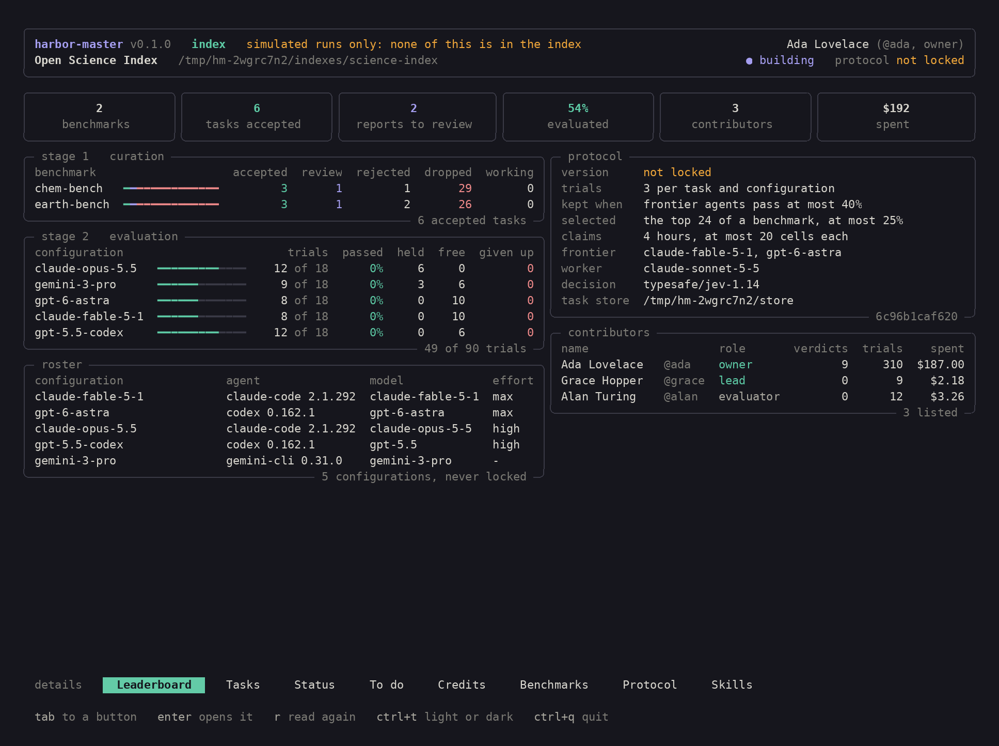

# Harbor-Master design

Harbor-Master takes a task or a benchmark in any format and returns a decision a person can sign: accept into an index, or drop, with the evidence. It holds no index of its own. Each index is a repository that says what it curates and how (Section 10). Section 14 says what is built, and Section 15 what is open.

## 1. What the Harbor process costs today

Source: Harbor Adapters and Harbor-Index, arXiv 2609.04298v3.

| Step in the paper | Who | Cost |
|---|---|---|
| Adapter creation, oracle check, parity (3 runs per side) | Contributor with a coding agent | Engineer time per benchmark |
| Review | Bot, then 1 to 3 reviewers, then a lead: over 10,000 GitHub comments | Human time |
| Difficulty filter: 18 frontier trials per task | Frontier models | 6,627 tasks in, 1,311 out |
| AI audit of 2 to 4 trajectories | Small model | 1,311 in, 307 out |
| Human review, panel, audit-and-fix loop | 14 reviewers, seniors repair by hand | 307 in, 82 out |

Frontier trials are spent before any audit, so broken tasks consume most of them. People do the repair. And it ran once. Harbor-Master puts cheap checks first, has agents repair, and never runs anything twice.

## 2. Three model tiers

| Tier | Default | Does |
|---|---|---|
| D, decision | `typesafe/jev-1.14` through OpenRouter | Every gate and routing choice: a typed value with a probability. It cannot write prose or code |
| W, worker | `claude-sonnet-5-5`, Claude Agent SDK | Adapters, repairs, audits, reports, drafting a benchmark's entry |
| F, frontier | `claude-opus-5-5` | Second judge on a contested audit, repair after W failed twice |

The worker and frontier tiers run on Claude models (provider `claude-agent-sdk`) or on OpenAI models (provider `codex`, through the Codex SDK and its sign-in to a ChatGPT subscription). A Codex session is read-only. The decision tier runs on Jev only, because a general model states a confidence, not a probability.

**Costs.** A cost that a provider reports is recorded as it is. Where none is reported, as with the Codex SDK and some agents on a subscription, the session or trial is costed from its tokens at the provider's published rate (`core/prices.py`: fresh input, cached input, cache writes, output), so it still counts toward the budget. A model with no list price there is recorded at 0.

A stage calls the next tier up only on a recorded trigger: low confidence, disagreement between two checks, or a retry limit. The share of tasks that reach tier F is reported for every run. The frontier models that are the *subjects* of the difficulty filter are a separate budget.

## 3. Intercom: typed records, no agent chat

Agents never message each other. Each stage reads a typed record and writes one, plus pointers to files on disk. The scheduler is ordinary code over those records.

- A tier D call is a schema and the text to read. It returns a value and a probability.
- Under the stage's threshold, the same schema goes to tier W, which adds a written rationale, and from there to tier F or a person.
- A W or F session ends in one JSON object that fits the stage's schema.

So every hand-off can be cached, compared across tiers, and checked by someone else.

## 4. Stages

| # | Stage | Runs on | Decides or produces | A task leaves when |
|---|---|---|---|---|
| 0 | Intake | Code | Fetches at the pinned commit, computes digests | |
| 1 | Triage | D, then W when unsure | The admission gates below | A gate fails |
| 2 | Adapt | W, then F, then a person. Once per benchmark, skipped for Harbor-format input | An adapter with a signed record that it passed, and the tasks it writes (Section 10) | The person abandons the benchmark |
| 3 | Verify | Code | Reference solution passes twice, a no-op fails, trivial submissions fail, the verifier is fast enough | Still failing after the retry limit |
| 4 | Probe | W and code, then D | Mutants of the solution test the verifier. Then one question: does the instruction state everything the tests check | The verifier or the instruction is wrong and repair fails |
| 5 | Difficulty | Worker model, then the evaluation suite | Two tries by the worker model, side by side. Then 2 frontier agents x 3 trials, in rounds, each at most 4 hours. Run once per task | The worker model solves it both times, or more than 40% pass |
| 6 | Audit | W; F when unsure and on a sample | Reads trajectories against the rubric, and says whether a failure is the task's, the agent's, or the infrastructure's | Broken and not repairable |
| 7 | Fix | W; F after two rounds | Repairs the task and returns it to stage 3. Stage 5 is not run again | Round limit reached |
| 8 | Report | W | One report per task: evidence, diffs, cost, recommendation | |
| 9 | Verdict | A person | Accept or reject, signed and credited | |

**Admission gates.** A task is kept only if all hold. Each failure has its own reason code, and the gates apply per task.

| Gate | Keeps | Settled by |
|---|---|---|
| Format | Tasks where an agent executes work, not multiple choice or short answers | D |
| Reference solution | A runnable one | Code, then stage 3 |
| Verifier | Programmatic and deterministic, not judged by a model or a person | D, then stage 3 |
| Verifier cost | Finishes within `max_verifier_seconds` on CPU, with no paid API | D estimates, stage 3 measures |
| Recency | The benchmark's release date is after the cutoff | Code |
| Reported results | No model is already reported to solve the task more than `max_reported_pass_rate` of the time. A task with no reported result passes | W reads the benchmark's own results once per benchmark, code compares |
| Leak | No file of the solution, and no test code or answer file, is also in the agent's image. The instruction does not quote the solution | Code |
| Duplicate | Not in the ledger already | Code, D for near matches |
| License | Allows use for evaluation | D |

**Ranking.** The rank comes from comparisons, because scores on a short scale tie.

1. *The lead's brief*: a few sentences on what matters in this benchmark, stored as a signed `brief` record.
2. *A score for every task*: tier D reads the brief and a short card of the task. One request per task.
3. *Pairs near the top*: the best `pool_factor` times the cap are compared in pairs, each pair in both orders, about 12 per task, and a Bradley-Terry model turns the results into a rating.
4. *A contributor approves the selection* before any trial is spent. The ranked tasks are shown in the order they are taken, each with a line on what it asks, on a page that opens by itself and has to be answered: a number k approves the top k, up to the cap, and a new brief ranks again.

Measured on the 70 tasks of Terminal-Bench-Science: 468 requests, $0.023, 11 seconds. The pool depends on the cap, not on the benchmark's size.

**Selection cap.** Only the top `min(top_k, max_fraction x N)` tasks of a benchmark go on to the costly stages: 24 of 1,000, 18 of 70. Selection goes round-robin over sub-areas. The rest are `not_selected`, not dropped.

**Cheap checks before the costly one.** Stage 5 is where the money goes, so everything that can fail a task for cents runs before it, and stage 5 runs once.

- *Trivial submissions* (stage 3, code). Besides the no-op, the task's output files are left empty, filled with a placeholder, and copied from a file that was already there. The output files are those the instruction and the tests both name. A verifier that accepts one goes to repair.
- *Coverage* (stage 4, one tier-D request, tier W when unsure). If the tests rely on a file name, format, unit or tolerance the instruction never states, the instruction is repaired here, not after the trials.
- *Cheap solve* (stage 5). The worker tier's model tries `cheap_trials` times side by side, each for at most `cheap_agent_hours`. If every try passes, the task is dropped as `solved_by_worker` and no frontier trial is spent. One pass among failures is not enough. Its tries are not leaderboard results.
- *Once per task.* Stages 3 and 4 loop through repair until they pass. A repair after stage 5 runs them again and carries the difficulty result forward on a record that names the digest it was measured on. The frontier trials are never run a second time, so a task accepted after such a repair has a difficulty measured before it.

**Early stop** in stage 5: with 6 trials and a 40% threshold, a task is dropped once 3 trials pass and kept once 4 fail.

**The final cut.** Accepting is each reviewer's call. Bringing the accepted set down to the index's final size is a judgement over the whole set: difficulty, diversity, and no few benchmarks dominating. It is made by hand, by the owner and by the contributors the owner names as leads (`role = "lead"`, set with `hm contributors role HANDLE lead`). The dashboard's Tasks button shows the accepted tasks and how many each benchmark has. `hm cut TASK <why>` signs a `cut` verdict: the task leaves `index.toml` and its archive is deleted from the task store. The cutter's machine keeps a copy, so `hm restore TASK` can put it back. `hm sync` rejects a cut signed by anyone else.

## 5. Where this goes beyond the paper

1. **Verifier probes before frontier trials.** A worker writes mutants of the reference solution: some wrong in a way that matters, some right in another form. The verifier must reject the first and accept the second.
2. **Calibrated escalation.** Every decision is stored with its probability, and every later overturn is a label. Thresholds can be refit on those labels.
3. **Sequential difficulty filter**, run once per task after a smaller model has tried, with early stop and reuse of any valid trial in the ledger.
4. **Content-addressed record.** A repair changes a digest, so the cheap checks that depend on it run again. The frontier trials do not.
5. **Credited human judgement.** A verdict carries who signed it and why, and is never asked for twice.

## 6. Working cells and parallelism

- **Once per benchmark**: fetching, the adapter, triage, the brief, ranking and selection. Triage is one batched pass, so a task that fails a gate never takes a cell.
- **One working cell per task in flight**: verify, probe, difficulty, audit, fix, report. `cells = 4` means four tasks at once. A cell holds one agent session at a time, and runs containers side by side where runs are independent: the mutants, and the suite's agents within a round.
- **Limits**: `cells`, `max_containers`, and a rate limit per provider. One asyncio process holds a semaphore for each. To scale past one machine, run on more machines against the same ledger: claims (Section 7) keep them apart.

## 7. Records

Nothing goes to Harbor during curation. Three stores hold the work.

| Store | Holds |
|---|---|
| The index's repository (git) | The index's definition, the ledger of small signed records, the reports |
| The task store (Section 8) | The accepted tasks, each as one archive |
| `.hm/runs/` on each machine | Trajectories, verifier output, logs. Not shared |

### IDs

- **Benchmark ID**: its short `id` on the index's list, such as `tb-science`.
- **Task ID**: `<benchmark ID>/<task name>`, stable for the life of the task.
- **Revision**: the content digest of the task's folder. A repair keeps the ID and gives a new digest, and every record names both.

### Events

Every record has `id`, `time`, `runner` (the GitHub handle of who made it), `protocol` (the settings hash), a signature, and the `id` of the one before it in its file.

| Record | Written when |
|---|---|
| `benchmark` | Someone puts a benchmark on the list, or takes it off |
| `contributors` | The owner signs the contributor list |
| `protocol` | The owner locks the settings, with a version |
| `submission` | A run takes in a benchmark's tasks, with their digests |
| `decision` | Any gate, the ranking, an adapter that passed or was abandoned |
| `trial` | Any run of an agent or the verifier on a task: purpose, agent and version, model, pass, tokens, cost |
| `repair`, `report`, `verdict` | The fix loop, the end of curation, a person's judgement |
| `claim` | Before the costly stages, and again when the run ends |
| `brief` | A lead says what matters |
| `usage`, `skip` | What the tiers were called for, and a benchmark a run left out (Section 12) |

A difficulty trial and a later benchmark trial are the same `trial` record with another `purpose`, and neither is tied to the protocol's version, so a difficulty trial is never run a second time for the leaderboard (Section 9).

### Skills: what each agent is told

Every prompt and criterion is a file, grouped by stage. Code holds the rules, skills hold the wording. The curation skills (`triage/`, `rank/`, `adapt/`, `probe/`, `audit/`) decide what gets into an index, so each index keeps its own copies under `skills/`, and they are part of the protocol hash. The session skills (`session/`: reading a typed line, answering a question, drafting a benchmark's entry) change no result and stay in the tool.

A skill's version is a hash of its file, and every record made with one names it, for example `triage/gates@dee91cd340`. So two wordings can be compared on the same tasks by their overturn rates and cost.

### Credit

Computed from the ledger: per person, tokens and dollars contributed, trials run, benchmarks added, repairs, verdicts. The dashboard's Credits button shows it.

### Never run twice

A trial slot is (task digest, agent and version, model, effort, trial index). A run refuses a filled slot and shows the existing result. Decisions and verdicts work the same way. Agent versions are pinned: each trial records the version the agent itself reported, and `hm sync` rejects a trial whose two versions differ.

### Two people at once

- **Claims.** Before the costly stages a run pulls, writes a `claim` naming its tasks with an expiry (`claim_hours`), and pushes. A claim belongs to a person on a machine: each machine has a short random name, kept with the identity, so the same person on a second machine is told the first one holds the tasks, as anyone else would be.
- **The push is the lock.** Git refuses a push when someone pushed first. The refused run pulls, sees the other claim, and gives way on what both claimed.
- **Screening** a benchmark is held by one person at a time, the same way.
- **A rerun is refused.** A task that has an outcome under this protocol is not run again. One that failed or was stopped has none, so it is free for anyone.

### Concurrent writers

Each run appends to its own file, `ledger/<benchmark>/<runner>-<run id>.jsonl`, with its own hash chain, so git never sees a conflict. A task's state is a fold over its records: for automated decisions the higher tier wins, and human verdicts are never overwritten.

### What is not solved by this

- **Trust.** A contributor could submit trials that never ran. Records are accepted only from listed people, signed. That is a rule, not a proof.
- **Contamination.** Public tasks contain reference solutions. Nothing is public before release.
- **Licenses.** A benchmark that forbids redistribution should not go into a public store. Nothing checks that yet.

## 8. Identity, local files, and what is uploaded

### Identity

`hm init` asks for a name, an affiliation, an email and a GitHub handle, and creates a signing key. Everyone runs it first. A person is identified by handle and key, never by name. The name, affiliation and email are listed in every index the person contributes to.

### What a run leaves on disk

```
~/.config/harbor-master/          identity, signing key, the theme
<workspace>/                      a clone of the index's repository
  about.toml  protocol.toml  roster.toml  contributors.toml
  benchmarks.toml  index.toml     written from the records
  skills/  adapters/<benchmark>/
  reports/<benchmark>/<task>.<digest>.md
  ledger/<benchmark>/<you>-<run id>.jsonl
  .hm/                            this machine only. Git ignores it
    hm.toml  owner  run.active
    sources/  adapted/  store/  simulated/  unkept.txt
    runs/<run id>/                run.json, tasks.jsonl, trials/, session.log
```

Nothing is stored twice. Harbor's output is kept only when it is evidence: an agent trial, or a run that went wrong. A simulated benchmark of 1,000 tasks leaves 64 KB in the run folder and 1.5 MB of ledger.

### API keys

Keys never enter a settings file, the ledger, or anything uploaded. `/keys` creates `secrets.env`, readable only by its owner and ignored by git, to fill in by hand. Environment variables come first. Claude and Codex each take an API key or a subscription sign-in. Each person uses their own keys, and `/doctor` shows which are found.

### Where each thing goes

| What | Goes to |
|---|---|
| The index's definition, adapters, ledger, reports | The index's repository |
| The accepted tasks | The task store |
| Trial archives, mutants, run summaries, statistics | Nowhere: `.hm/` on the machine that made them |
| Identity and keys | Nowhere |

### The task store

A later benchmark run must run exactly the task that was accepted. Tasks are too large for git (the largest of Terminal-Bench-Science is 196 MB), a repaired task exists only where it was repaired, and a source can disappear. So each accepted task is kept as `tasks/<benchmark>/<task>.<digest>.tar.gz`.

- **Every index has one**, named in `about.toml`: a Hugging Face dataset repository, `org/name`. `hm new --tasks` names it and creates it, private. A folder's path also names a store, which the tests use. Only the index that `/demo` makes has none.
- **Each person uses their own token**, `HF_TOKEN`, with write access that the owner grants on Hugging Face. Reading a public store needs no token.
- **A real run checks it first**: the store is named, exists, and the token is there. Whether the token may write shows at the first upload.
- **Accepting a task uploads it.** A failed upload is reported and noted on the machine, and its next `hm sync` tries again. `hm eval` fetches an accepted task from the store when it needs one.
- **`hm eval` runs the accepted version or does not run the task.** A copy that does not match its digest is thrown away.

### Reports

A reviewer signs from the report, so it is written into the index's repository and committed with the run's records. Its record holds a checksum, and a report changed afterwards is reported.

### What is not shared, and what that gives up

Trial archives stay on the machine that made them. The ledger holds each trial's result, so nothing the system does needs them elsewhere. What is given up: nobody else can open a trajectory to check a trial.

## 9. Stage 2: evaluating the released index

An index has two stages, and each is a way to contribute. Stage 1, *curate*, builds it: `hm open` and the screens. Stage 2, *evaluate*, runs agents on it: `hm eval`, in a shell. The owner's `hm release` is the switch: it locks version 1.0.0, writes a signed `release` record, closes curation (the final cut stays open to the owner and the leads) and opens evaluation.

- **The to-do list is computed, not stored.** It is every accepted task, at its accepted version, with every configuration of `roster.toml`, `eval.trials` times. A *cell* is one task with one configuration. Everyone who pulls computes the same list from the index, the roster, and the trials there are (`ledger/evals.py`). `hm todo` shows it.
- **Order.** The least covered cells come first, then a fixed shuffle (the hash of the cell), so coverage grows evenly and two people do not start at the same end.
- **Claims.** `hm eval --take K` pulls, takes the next K free cells, writes a signed `claim` that runs out after `eval.claim_hours` (4), and pushes. The push is the lock. Each person writes only their own file, so two pushes never conflict, and of two claims on a cell the earlier one holds it: after its push, a run reads the list again and keeps only the cells it holds. Nobody holds more than `eval.max_claim` (20). There is no record for giving a cell back: a finished trial fills its slot, and an unfinished claim runs out.
- **A trial is not tied to the protocol's version.** Its slot is the task's version, the agent and its version, the model, the reasoning effort, and the trial's number. So a difficulty trial of stage 1 fills the slot of the same configuration in stage 2, and is not run again. A task that was repaired after its difficulty run is evaluated afresh, because the accepted version is one no agent attempted.
- **The same trial in both stages.** Both call the same backend function and keep the same Harbor trial folder. The record of stage 2 has the fields of a difficulty trial, less the ones only curation reads (`protocol`, `benchmark`, `verifier_seconds`, `task_checksum`), and `agent_version_ran` only when a build other than the pinned one ran.
- **Records.** `eval/<handle>.jsonl`, one file per person, each line signed and chained to the one before. Three kinds:

```json
{"v":1,"type":"release","time":1795100000,"runner":"owner","version":"1.0.0","tasks":120,"index":"sha256:…","trials":3,"prev":"","id":"…","sig":"…"}
{"v":1,"type":"claim","time":1795103000,"runner":"ada","machine":"ab12…","expires":1795117400,"cells":["<task digest>#<configuration>"],"prev":"…","id":"…","sig":"…"}
{"v":1,"type":"trial","time":1795106211,"runner":"ada","task_id":"bench/task","digest":"…","agent":"claude-code","agent_version":"2.1.292","model":"…","reasoning_effort":"max","trial_index":1,"purpose":"benchmark","passed":false,"reward":0.0,"tokens_in":1840000,"tokens_out":52000,"cost":6.41,"container_seconds":2710.0,"error":"","artifact":"sha256:…","prev":"…","id":"…","sig":"…"}
```

- **The trial folder** is Harbor's own: `agent/` with the trajectory, `verifier/`, `artifacts/`, `config.json`, `lock.json`, the result. It is kept whole, as one archive, in `trials/` of the task store, named by its digest, which the record carries. It never goes to git: a trajectory holds the task's content, and the index's repository is public.
- **Failures.** A trial that fails for an infrastructure reason is recorded with its `error` and fills no slot. After `eval.retries` (2) more of them the cell is given up: it leaves the to-do list and shows in `hm todo`.
- **Who.** Everyone on the contributor list may evaluate. The role `evaluator` may do only that: their signature on a curation record is refused. A configuration whose key a machine lacks is left to others.
- **The eval screen** (`tui/evals.py`) is laid out as the curate screen is: header, one line of figures, the roster's configurations, the working cells, what happened last, a tip. It has no prompt and four keys: pause, leave, light or dark, end. It draws an `Evaluation` (`engine/evaluate.py`), which takes cells, runs them side by side and takes more until none is free. It runs behind the same relay as a curation run, so it goes on when its terminal closes, and `hm eval` inside the index's folder shows it again. `hm eval --plain` does one take with no screen.
- **The demo.** `hm eval --demo`, or *Evaluate* at the end of `hm init`, curates the made-up benchmark in a simulated run with nobody asked, accepts what reaches a report, and opens the eval screen on those tasks. Where the roster is still empty, the difficulty suite and one made-up agent stand in for it.
- **Checks.** `hm sync` checks `eval/` too, before it pushes: each file is its signer's, the chain holds, the signatures match, only the owner released, and no slot is filled twice.
- **Agents come from Harbor.** Harbor is a dependency, and its list of agents is the list: any agent the installed Harbor has can be benchmarked. Harbor names agents, not models, so the pairs with a short name are ours: `core/presets.toml` holds ten configurations, the ones run on Autonomous Science Bench, and the roster's template names them. A roster entry, or an entry of the difficulty suite, takes one with `use = "NAME"`; a field written beside it, such as `version`, replaces the preset's. A trial gets only the keys its own configuration can use.
- **The leaderboard** is computed each time from `eval/` and from the difficulty trials of `ledger/`: a configuration's pass rate on each task, averaged over tasks. Infrastructure failures are left out. A configuration that has not run every task is shown as incomplete. Each row says how many of its trials are ones the tasks were selected on, since those agents were chosen against.

## 10. Config

### The index repository

Each index is a git repository of its own: its definition and its ledger. A clone is the workspace.

| File | Says | Who changes it | How it is protected |
|---|---|---|---|
| `about.toml` | Name, description, the task store | The owner, shared with `hm sync` | Changes no result |
| `protocol.toml`, `skills/` | Every setting and wording that can change a result | The owner, by locking | The protocol hash is locked |
| `roster.toml` | Which agents the leaderboard compares | The owner, at any time, shared with `hm sync` | Not locked: every trial record names its configuration, so a change alters no recorded result |
| `contributors.toml` | Who may contribute, and their keys | The owner, with `hm contributors add` | The owner signs each change |
| `benchmarks.toml` | The list of benchmarks | Nobody by hand | Written from signed records |
| `adapters/<benchmark>/` | Code that writes Harbor tasks from another format | The run that first takes the benchmark | A signed record that this version passed |
| `ledger/`, `reports/`, `index.toml` | The records, the reports, the accepted tasks | `hm` | Signed, chained, checksummed |

- **Whom a clone trusts.** Everything rests on the owner's signature. A workspace remembers the owner's handle and key from the day it joined (`.hm/owner`) and refuses a copy that names another.
- **What a run commits.** Its records, its reports, and `benchmarks.toml`. The definition is committed only by the owner's commands.
- **Skills.** `hm new` copies the templates into the index. An index may reword a skill freely but not change its structure, and a copy the code cannot use is refused. `hm lock` copies in the template of a skill the index has no copy of.
- **The tool's version.** `[requires] harbor_master` is the oldest tool that may run the index.

**The list of indexes.** `indexes.toml` in the Harbor-Master repository holds one entry per index: name, address, the owner's handle and key. It is read from the main branch, so a new entry needs no release. Everything else about an index is read from its own repository. Getting listed is a pull request with what `hm entry` prints, checked by `hm indexes --check`. `/join NAME` checks the clone against the owner's key on the entry. A site built from this list is not built.

### The benchmark list

Anyone on the contributor list adds a benchmark, and the owner does nothing for it.

- **One list.** `/benchmarks add URL` ends in a signed `benchmark` record. `benchmarks.toml` is the list as one file, written from the records after every pull. Editing it changes nothing.
- **Checked before and after.** Adding pulls first and refuses a repository or an ID that is listed already, saying who added it. Confirming pulls and checks again. When two people add at once, the pull settles the file by itself.
- **A person gives an address.** Code pins the newest tag and its commit, finds the tasks, and reads the licence. A worker-tier agent reads the repository and drafts the name, description, paper and release date. The release date is what the recency gate compares; where the repository does not say, the pinned commit's date stands in and the draft says so. The person replies `y` or says what to change, and nothing is signed before the yes.
- **The pin stays.** Only the adder or the owner may replace an entry or take it off.
- **Why it is safe to leave open.** Adding spends nothing and admits nothing.

### Adapters

A benchmark whose tasks are not Harbor task folders needs an adapter. It has Harbor's own adapter layout, so one built here can be offered to Harbor.

- **A run builds it by itself.** The worker model writes it, the checks run, and a failing one goes back with its failures, to the frontier model after two rounds. A person is asked, in a box, only when the models fail: fix the files and check again, or abandon the benchmark.
- **The checks need no model:** the layout is complete, it runs, every task is complete, a second run writes the same tasks by digest, and a few reference solutions pass through Harbor.
- **A signed record vouches for it.** A run uses an adapter only when someone on the list signed that this very version passed. A changed adapter is checked again. It needs no lock.
- **Its code runs in a container** with no network and read-only mounts.
- **An abandoned benchmark is refused to every run**, with who abandoned it and why, until it is taken off the list and added again, which reopens it.
- **Not built:** parity against the original harness, and adapters that need more than the standard library.

### The two settings files

| File | Holds | Who changes it |
|---|---|---|
| `protocol.toml`, in the index | Tiers and models, gates, thresholds, the difficulty suite | The owner, by locking |
| `.hm/hm.toml`, on each machine | Cells, containers, budget, sandbox | Whoever runs there |

Both are written commented by `hm new`. The defaults are in `templates/protocol.toml` and `hm.example.toml`.

| Setting | Default |
|---|---|
| `escalation.min_confidence` | 0.85 |
| `triage.released_after`, `max_verifier_seconds`, `max_reported_pass_rate` | 2025-06-01, 300, 0.5 |
| `select.top_k`, `max_fraction`, `comparisons_per_task` | 24, 0.25, 12 |
| `difficulty.suite` | Fable on Claude Code, GPT-6 Astra on Codex, both pinned |
| `eval.trials`, `claim_hours`, `max_claim`, `retries` | 3, 4, 20, 2 |
| `difficulty.max_pass_rate`, `max_agent_hours` | 0.40, 4 |
| `difficulty.cheap_solve`, `cheap_trials`, `cheap_agent`, `cheap_agent_hours` | true, 2, claude-code, 1 |
| `adapt.max_rounds`, `fix.max_rounds` | 3, 3 |
| `run.cells`, `max_containers`, `budget_usd` | 4, 16, 200 |

### The protocol lock

A curation must run under one fixed set of settings, or its results cannot be compared.

- **The hash** covers every setting in `protocol.toml` except `[requires]`, and every curation skill.
- **Locking.** `hm lock`, owner only, writes a signed `protocol` record with the hash, the settings and a version. Only what can change a curation's result is locked. Benchmarks, adapters and contributors each have a signed record of their own.
- **The roster is never locked.** It names the agents to evaluate, which changes how no task is curated, and new models keep coming out. The owner edits `roster.toml` at any time, before the release and after it, and shares it with `hm sync`. A new configuration adds its cells to the to-do list; trials already recorded name their own agent, version, model and effort, so they stand.
- **Versions.** Every index starts at 0.0.0. A lock keeps the version unless the owner asks for a new one: `hm lock patch` for a small change such as a skill's wording (0.0.1 to 0.0.2), `hm lock minor` for changed settings (0.1.0 to 0.2.0). 1.0.0 is the index's release, which `hm release` sets, once. The hash on every record stays the exact identity of the settings.
- **Before every run** the local hash is compared with the locked one. A difference is refused, with what differs. A real run needs a lock. The owner is asked to lock right there.
- **The contributor list** is signed by the owner at each `hm contributors add`, `role` or `remove`, and a copy that differs from the signed one is refused.
- **In the ledger.** `hm sync` fails on a lock signed by anyone but the owner, and on records made under a hash that was never locked.

## 11. CLI

Python, installed as `hm` with `uv tool install --editable .`. Typer defines the commands, Textual draws the screens, Rich prints.

**A shell for managing, and two screens for contributing.**

| Where | Commands | For |
|---|---|---|
| Any folder | `hm init`, `hm indexes`, `hm open INDEX`, `hm new INDEX --tasks ORG/NAME --repo OWNER/NAME` | Everyone. `hm new` makes its caller the owner |
| Inside an index's folder | `hm benchmarks [add, revise, confirm, remove]`, `hm curate`, `hm sync`, and after the release `hm eval`, `hm todo` | Everyone |
| Inside an index's folder | `hm contributors [add, role, remove]`, `hm lock [patch, minor]`, `hm release`, `hm entry` | The owner |
| Inside an index's folder | `hm open` (the dashboard), `hm cut TASK why`, `hm restore TASK` | The owner and the leads |

- **`hm` alone is an error** that lists these. A command about an index typed outside one is refused, with a line that says to `cd` into the index's folder.
- **Only `hm init` asks in boxes** (`tui/wizard.py`): one question per box, a line to type in or a button for each choice, Cancel and Next at the right. It is the whole onboarding, the same for everyone, and run again it is how a person changes their details: each box shows what the machine has, to keep with enter or type over, and the signing key is kept. It asks who you are and makes the signing key, an index to join (or a practice index on this machine when none is named), the keys file, and a simulated demo of either stage, which is its one choice. A machine runs 4 tasks and 16 containers at once unless its own settings say otherwise. `hm new` and `hm open` are plain commands.
- **`hm open INDEX` clones.** It takes a name from the list of indexes or a repository's address, clones it into a folder here, and refuses it unless it is an index: a `protocol.toml`, and an `about.toml` with the canary line (`harbor-master-canary GUID ...`, written by `hm new`). A refused clone is removed. Inside an index's folder, `hm open` alone shows the dashboard.
- **What an index is made of is its owner's files.** `about.toml`, `protocol.toml`, `roster.toml` and `skills/` are edited in the repository. `hm lock` signs `protocol.toml` and `skills/`; `hm sync` shares `about.toml` and `roster.toml`. No screen changes them.
- **There are no other commands.** Fifteen, all in `hm --help`, none hidden. What the old ones did is done by the run itself (fetching a benchmark, writing its adapter, putting an accepted task in the store), by `hm lock` (copying in missing skills, creating the task store), by `hm sync` (checking the ledger, retrying a task that did not reach the store), or shown on the dashboard. An abandoned benchmark is reopened by taking it off the list and adding it again.

`hm curate` also takes `--demo`, `--tasks`, `--until select|verify|probe`, `--assume-after`, `--plain` and `--no-input`. `hm eval` is stage 2 (Section 9).

### The dashboard



`hm open`, inside an index's folder, shows its owner and its leads where the index stands. Everyone else is told to use `hm curate` or `hm eval`.

- **Read only.** Nothing is started from it and nothing is changed. It has no line to type in.
- **The header** is the one every screen has: the tool, the index, the person and their role, the stage (building or released) and the lock.
- **Six figures**: benchmarks, tasks accepted, reports to review, how much is evaluated, contributors, spent.
- **Panels**: curation, a row and a bar per benchmark (accepted, to review, rejected, dropped, in work); evaluation, a row and a bar per configuration (trials done, passed, held, free, given up); the roster; the protocol's main settings; the contributors, with what each signed, ran and spent.
- **Buttons** open the details in a box to read and scroll: Leaderboard, Tasks, Status, To do, Credits, Benchmarks, Protocol, Skills. They are functions, not commands (`cli/views.py`); `hm todo` prints the same To do.
- **Figures are read from the records** (`tui/home.py`, `gather`), again every few seconds, so a run that is going moves them. While an index has only simulated runs, their figures are shown, and the header says so.
- **The curate and eval screens have none of this.** Each shows its own run and nothing else, so no feature is in two places.

**What a simulation is.** One backend stands in for all three model tiers and for Harbor. Each task gets hidden properties drawn from its digest (is it hard, is its verifier broken, can it be repaired), and every answer is one more draw from that digest, so a run can be repeated exactly. Nothing is computed for long: a 40-task run takes a fraction of a second. The only time it takes is a pause: two seconds for each pretend agent session or container run, and ten or more for each agent's attempt at a task, so that the difficulty run is visibly the long stage. `--speed 0` removes the pauses. A simulated run is a walk-through: the first time it reaches a stage, it says what the stage does, in the tip line and in the log. It sends every task that passes the gates through the stages, up to `top_k`. `hm curate --demo` adds one benchmark of 10 made-up tasks to that index, on this machine only, and starts a simulated run of it, which takes two to three minutes.

**A simulated run never counts as real.** Its records go to `.hm/simulated/`, never to `ledger/`. Each carries `simulated: true` inside what is signed. A real ledger leaves such a record out, and `hm sync` reports one. The dashboard and `hm todo` show simulated records while an index has nothing else, and say so.

### A run outlives its terminal

```
terminal  <->  view (hm run)  <- socket ->  relay  <- pseudo-terminal ->  the run and its screen
```

- **Leaving.** `ctrl+l`, closing the window, or a lost connection closes the view. The run goes on, whether it curates or evaluates.
- **Coming back.** `hm curate` or `hm eval` inside the index's folder, from any terminal, opens a view on the run that is going.
- **One run per index**, of either stage. Two indexes run side by side, each behind its own relay.
- **A finished run stays**, for verdicts or more benchmarks, until `ctrl+q`. The curate screen has eight commands for the run that is going.
- **Ending cleanly.** A run told to end releases its claims, writes its usage, and pushes.
- **It does not survive a reboot.** The next run reuses everything that was recorded.

### The session screen


Header, summary, benchmarks, working cells, recent outcomes, and a prompt. The answer and confirm panels open only when needed. On a short terminal the cells stay and the other panels give way. Teal is done or kept, purple running, amber needs attention, red dropped. `1`-`9` opens a cell.

### Boxes, not commands

**No screen has a prompt.** A person cannot type a command, so nothing they do can upset a run. What they decide, they decide in a box that the run opens and that has to be answered before anything else:

| Box | Opens when | The choices |
|---|---|---|
| A brief | A benchmark has passed its gates | A sentence or two, typed |
| The selection | The tasks are ranked | How many go on, typed |
| A report | A task reaches its report | `accept` or `reject <why>`, typed under it |
| The budget | Nine tenths of it is spent, and again when it is gone | Raise it (to twice as much), or keep it; when it is gone, raise it or end the run |
| A failed trial | A trial fails for an infrastructure reason | Retry, or discard. It says the task, the trial and the error |
| An adapter | The models cannot make one pass | `recheck` or `abandon`, typed |
| Ending | `ctrl+q` | Keep it going, or end the run |

The choice boxes are one widget (`tui/parts.py`, `ChoiceBox`), used by all three screens. The keys are few: a cell's number opens its task, `ctrl+p` pauses, `ctrl+l` leaves, `ctrl+t` switches light and dark, `ctrl+q` ends. The commands behind the boxes are still in `interact/`, where the boxes and the relay run them. With nobody to ask (`--no-input`, `--plain`), a failed trial is recorded as it is and the run stops taking tasks when the budget is gone.

### When the system asks the user

Each need becomes a request, and each request opens its box. Only the work that depends on the answer waits.

| Request | Raised when | Blocks |
|---|---|---|
| Brief | A benchmark has no brief | Its ranking |
| Selection | The ranking is done and not approved | Its costly stages |
| Adapter | The models could not make an adapter pass | That benchmark |
| Budget | Nine tenths of the limit is spent, and again when it is gone | Nothing at first, then new tasks |
| Failure | A trial failed to run | That trial |
| Verdict | Reports are ready | Nothing |

With `--no-input` nothing prompts: dependent work is skipped, the rest runs, and the exit code says requests remain.

## 12. What a run reports

Everything a paper needs is computed from the ledger. Two records exist for it: `usage` (calls, tokens and cost per benchmark, stage and tier) and `skip` (a benchmark a run left out, and why).

All of it can be computed from the ledger, which records every model call, decision and trial. No command writes it as a report yet.

## 13. Estimated curation cost

Modeled, not measured. Per 1,000 tasks entering, with no selection cap, without the frontier difficulty trials that every approach must run. Assumes $0.30 per Sonnet session, $1.50 per Opus call, $50 per reviewer hour.

| | Harbor-Index | Ours | Ours, one Opus does everything |
|---|---|---|---|
| Agent cost | ~$15 | ~$525 | ~$2,700 |
| Human hours | ~130 | ~15 | ~15 |
| Total | ~$6,500 | ~$1,300 | ~$3,450 |

Ours spends about $500 more on agents and saves about 100 expert hours. The verifier probe is its largest line (~$260). With the selection cap, at most 24 tasks of a benchmark reach the costly stages, so the cost no longer grows with a benchmark's size.

## 14. Implementation status

As of 2026-11-19. The package is `src/harbor_master`. 82 tests, on simulated backends and local git repositories.

```
src/harbor_master/
  cli/         the hm commands, one module per group
  tui/         the index's screen and the run screen, colors
  interact/    what a user can type, and the guide
  skills/      what each agent is told
  engine/      a run: session, shared (per benchmark), prepare (fetch and adapt), stages (per task)
  backends/    who decides and who runs trials: real and simulated
  curation/    the rules as pure functions
  ledger/      records, the fold into state, verification, sharing, statistics
  tasks/       the Task model, the benchmark list, adapters, the task store
  core/        config, identity, keys
  templates/   the files a new index starts from
  host.py      the relay that keeps a run alive
```

| To add | Change |
|---|---|
| A stage | One function in `engine/stages.py` |
| An admission gate | Its wording in `skills/triage/gates.toml`, its rule in `curation/gates.py` |
| A session command | One decorated function in `interact/handlers.py` |
| An `hm` command | One function in the matching `cli/` module |
| A record type | `ledger/events.py`, and its rule in `ledger/fold.py` |

**Built and tested in simulation:** the whole pipeline, the ledger and its checks, both screens, the index as a repository, sharing with claims, the benchmark list, adapters, the task store behind a folder, statistics, the run that outlives its terminal.

**Tried for real, on Terminal-Bench-Science tasks:**

- Harbor in Docker for the reference solution, a no-op and a mutant.
- The gates and the ranking on Jev: 40 gate decisions and the comparisons for under $0.001. Escalations to Sonnet cost about 200 times more than everything Jev did.
- A hand-written adapter in the container, with a reference solution passing through Harbor.
- `hm open INDEX` and the listing check against GitHub.

**Never run for real:**

- A model writing an adapter, or drafting a benchmark's entry.
- Any tier on the `codex` provider.
- Agent trials for the difficulty filter, the worker model's first tries, and the audit, repair and report on real trajectories.
- The agent that reads a benchmark's per-task results, the coverage question on a real model, and trivial submissions through Harbor. The leak scan and the trivial submissions are heuristics, tested on made-up tasks only.
- The task store against Hugging Face.
- A benchmark trial through `hm eval`.

**Not built:** parity runs, the exploit agent, recalibrating thresholds, `hm contribute`, `hm publish`, the site of indexes, and the session commands `/logs`, `/trajectory`, `/restart`, `/retry`, `/escalate`, `/limit`. Task digests still use a stand-in hash, not Harbor's.

## 15. Open

- Jev in practice: input length, latency under load, and whether its probabilities are calibrated on these gates.
- Parity when the original harness cannot run.
- A benchmark whose licence forbids redistribution, and the task store.
