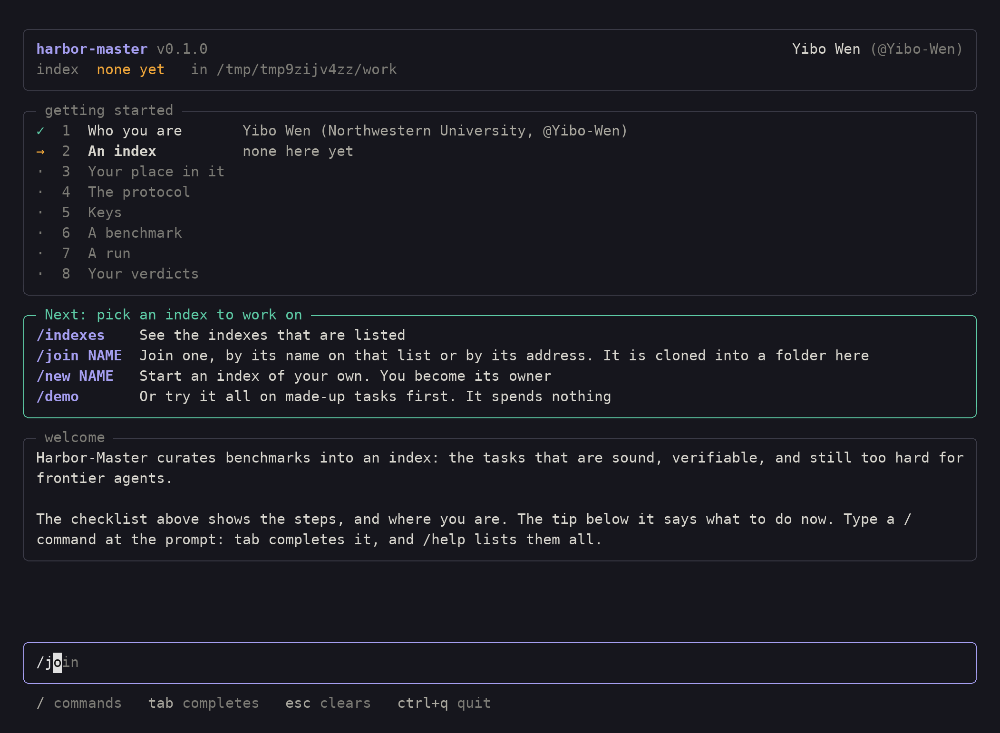

<h1 align="center">Harbor-Master</h1>

<p align="center">
  <strong>Harbor-Master</strong> curates benchmarks into an <strong>index</strong>: the tasks that are sound, verifiable, and still too hard for frontier agents. The first one is the <strong>OpenSSI Index</strong>, of scientific tasks. It takes a task or a benchmark, checks it in stages ordered by cost, repairs what is broken, and hands a human reviewer a report to sign.
</p>
<p align="center">
  Every decision, trial, and verdict is written to a <strong>signed ledger</strong>, so nothing is run or judged twice and anyone can check how a task got in.
</p>

<p align="center">
  
</p>
<p align="center">
  <em>One run. Each working cell carries a task through the stages. The prompt takes commands, plain instructions, and questions, and asks before anything changes the run.</em>
</p>

> **Status.** The pipeline, the ledger, and the screen are built and tested on a **simulated backend**, which spends nothing. On real tasks, the admission gates and ranking (on Jev), and the verify stage (Harbor runs in Docker) work. The audit, repair, and report on real trajectories are not built, and real agent trials for the difficulty filter have never been run. [DESIGN.md](DESIGN.md), Section 14, lists exactly what is and is not.

## How it works

Three model tiers share the work. A fast **decision** model makes every gate and routing choice. A **worker** model builds, audits, and repairs. A **frontier** model is called only when the first two are unsure or stuck. Cheap checks come first, so the expensive ones see few tasks.

For each benchmark, Harbor-Master:

1. **Admits** tasks that an agent must execute, that ship a reference solution, and that a program can verify quickly. Multiple choice and question answering are filtered out.
2. **Ranks** the admitted tasks by importance under a brief from the field lead: each is scored once, and the ones near the top are then compared in pairs. It **selects** the top ones: at most 24 per benchmark, and at most a quarter of it. The lead approves the selection before any trial is spent.
3. **Verifies and probes** each selected task: the reference solution must pass, a no-op must fail, and the verifier must reject wrong answers and accept right ones in another form.
4. **Filters by difficulty**: two frontier agents attempt the task, for at most 4 hours a trial, and it is kept only if at most 40% of trials pass.
5. **Audits and repairs**: an auditor reads the trajectories, and broken tasks are fixed and sent back through the checks.
6. **Reports** to a reviewer, who accepts, rejects, or sends back. A benchmark may have at most 8 tasks in the index, so a ninth must replace one.

Tasks run in parallel in working cells. The design, the cost estimate, and the reasons behind each choice are in [DESIGN.md](DESIGN.md).

## Quick start

You need Python 3.11 or later and [uv](https://docs.astral.sh/uv/). A simulated run needs no keys and no Docker.

**1. Install it, and open it.**

```bash
cd harbor-master        # after cloning this repository
```

```bash
uv tool install --editable .
```

```bash
hm
```

`uv tool install` puts the `hm` command on your path, so nothing needs `uv run`. `--editable` makes it follow the code in this folder. If you would rather not install it, `uv sync` and then `hm ...` works the same.

`hm` on its own opens the home screen. It needs nothing set up: a checklist shows the steps and where you are, and the tip under it says what to do now, with the commands for it.

<p align="center">
  
</p>

**2. Follow the tips.** For a first look, three commands are enough:

| Type | What happens |
|---|---|
| `/init` | It asks your name, affiliation, email and GitHub handle, and makes your signing key |
| `/demo` | It starts an index called `hm-demo` in this folder, with a made-up benchmark in it |
| `/run --simulate` | The run screen opens, on simulated models and trials. It spends nothing |

To work on a real index, the tip offers the other ways in: `/indexes` shows the ones that are listed, `/join NAME` joins one, and `/new NAME` starts your own. From there the tips lead through what a real run needs: your place on the index's contributor list, a locked protocol, keys (`/doctor`), and a benchmark (`/submit ID`).

**3. Answer the run.** On the run screen, commands start with `/`, and `tab` completes them and their arguments. The line marked `tip` says what the run needs from you. It stops twice to ask, in the amber panel: first for the lead's brief (`/brief demo-bench <what matters>`), then to approve the selection (`/approve demo-bench`). When reports are ready it tells you, and `/review` lists them. If it pauses on the $200 budget (simulated money), raise it with `/budget 500`. `ctrl+q` goes back to the home screen.

**4. Read the results.** From the home screen, `/status --simulated` shows where every simulated task stands. For real runs, `/status` shows the index itself, `/verify` checks that the record is sound, and `/credits` shows who contributed what.

**Simulated is never real.** A simulated run keeps its records in `.hm/simulated/` on your machine, each one marked as simulated inside its signature. They are never written to the index's ledger and never pushed, and a real ledger ignores and reports any that are copied in. So `--simulate` is safe in any index. To see what simulated runs did, add `--simulated`: `/status --simulated`, `/leaderboard --simulated`.

**Without the screen.** Every command on the home screen is an `hm` command in a shell: `hm init`, `hm demo`, `hm run --simulate`, `hm status`. `hm guide` prints the checklist and the tip as text, and so does `hm` where there is no terminal. `hm --help` lists them all.

An index is a git repository of its own, and its folder is your workspace: `hm` works from anywhere inside it. The file to know first is `protocol.toml`, the curation protocol: every setting that can change a result, the same for everyone, and locked by the owner with a checksum in the ledger. Your own machine's settings, such as parallelism and budget, are in `.hm/hm.toml`, which git ignores and is yours to change ([`hm.example.toml`](hm.example.toml)).

**One tool, many indexes.** Harbor-Master holds no index. Each index is its own repository, and that repository is all of it:

| File | Says |
|---|---|
| `about.toml` | What the index is: name, title, description |
| `protocol.toml` | The curation protocol |
| `benchmarks.toml` | The benchmarks that may be curated, each pinned to a release |
| `roster.toml` | The agent configurations benchmarked on the index |
| `contributors.toml` | Who may curate, in which fields, and their signing keys |
| `skills/` | What the agents that curate this index are told. Copied from the tool's templates, and yours to reword |
| `ledger/` and `index.toml` | Every record, and the accepted tasks |

Only the owner changes the first six. `hm skills` shows where the index's skills differ from the templates, and `hm skills adopt` takes a newer template in. `hm protocol lock` signs their checksums into the ledger, and a run whose copy differs is refused. `hm index new NAME` starts an index with you as its owner, `hm index connect URL` shares it through a git repository, and `hm join URL` clones one. A workspace remembers the owner's key from the day it joined, and refuses a copy that names another owner.

**The list of indexes.** [`indexes.toml`](indexes.toml) lists the indexes that asked to be listed, each with its repository and its owner's key. `hm indexes` shows them, and `hm join NAME` joins one by name. The list holds addresses only: everything else about an index is read from its own repository. To list yours, run `hm index entry` in it and add what it prints in a pull request here. The check on the pull request clones the repository and makes sure it is a sound index with the owner the entry names.

**Which benchmarks.** The index's `benchmarks.toml` lists the benchmarks that may be curated into it, each with its release date, repository, and a pinned commit. Real runs work only on these: `hm benchmarks` shows the list, and `hm submit tb-science` fetches one at its pinned release. A local folder registered with `--dev`, like the synthetic one above, runs under `--simulate` only.

**Who may contribute.** The index's `contributors.toml` lists the people allowed to submit records and sign verdicts, each identified by a GitHub handle and the public key that `hm init` prints. To be added, send that key to the index's owner. `hm contributors` shows who can contribute and who still needs a handle or a key. Each person curates only the fields listed for them.

**Working with others.** Everyone who joined an index works in a clone of the same repository. A run pulls before it starts, claims its tasks, and pushes the claim: if someone else claimed first, the push is refused and the run gives those tasks up. A task someone holds, or one that already has an outcome, is not run again. A task that fails or is stopped is let go. A run pushes only its own records, never a change to the files that define the index. `hm claims` shows who holds what, and `hm sync` pulls and pushes by hand.

**The index and the leaderboard.** A task enters the index when a contributor accepts it. The accepted tasks are listed in `index.toml`, which `hm` writes from the signed verdicts and nobody edits. `roster.toml` lists the agent configurations to benchmark on them. `hm todo` shows what is still to run, `hm eval --config NAME` runs one, and `hm leaderboard` ranks the configurations on the accepted tasks only.

**Keys, for real runs.** `hm keys init` copies [`secrets.env.example`](secrets.env.example) to `secrets.env` in the Harbor-Master folder, readable only by you. `secrets.env` is in `.gitignore`, so git never picks it up. Fill in the keys you have: Claude and Codex each take an API key or a subscription sign-in. `hm doctor` shows which are found and what they let this machine run.

## Repository

```
src/harbor_master/   one package per component: cli, tui, interact, engine, backends, curation, ledger, tasks, core
src/harbor_master/skills/   the templates of what each agent is told, one file per job. Each index keeps its own copies
tests/               one file per component
tools/               screenshot.py, which captures the pictures in assets/ from the running screen
src/harbor_master/templates/   the blank files a new index starts from
indexes.toml         the list of indexes: name, repository and owner of each
hm.example.toml      one machine's own settings: parallelism and budget
DESIGN.md            the design, the cost estimate, and the implementation status
```

## Citation

```bibtex
@misc{openssi2026harbormaster,
  title={Harbor-Master: Scalable Multi-Agent Infrastructure for Open, Continual Benchmark Indexes},
  author={The OpenSSI Team},
  year={2026}
}
```
