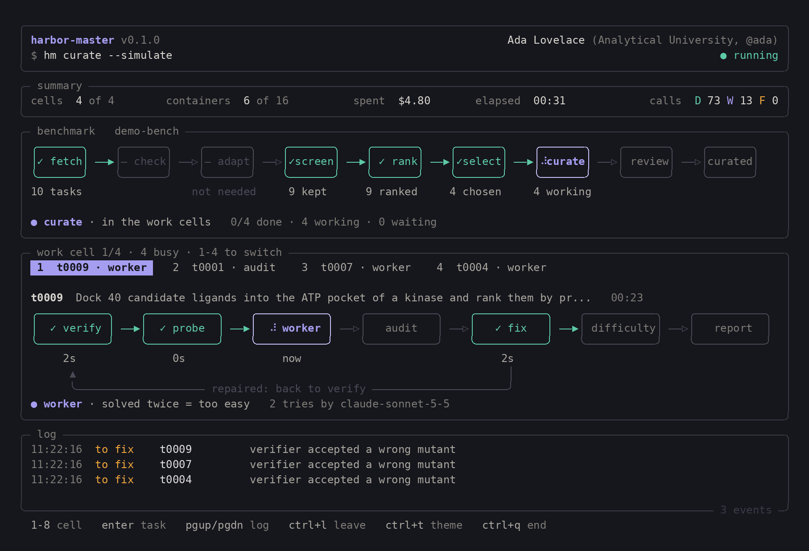

<h1 align="center">Harbor-Master</h1>

<p align="center">
  <strong>Harbor-Master</strong> curates benchmarks into an <strong>index</strong>: tasks that are sound, verifiable, and still too hard for frontier agents. It checks each task in stages ordered by cost, repairs what is broken, and hands a person a report to sign. Every decision, trial and verdict goes into a <strong>signed ledger</strong>, so nothing runs twice and anyone can check how a task got in.
</p>

<p align="center">
  
</p>

> **Status.** Built and tested on a simulated backend that spends nothing; real runs have been tried end to end on two benchmarks. [DESIGN.md](DESIGN.md), Section 13, says what is built.

## Install

You need Python 3.12+ and [uv](https://docs.astral.sh/uv/).

```bash
uv tool install git+https://github.com/Open-SSI/harbor-master
hm init                          # who you are, and your signing key
```

Try it on a made-up index, with no keys and no Docker:

```bash
hm clone demo-index && cd demo-index
hm curate --demo                 # curate a made-up benchmark, simulated
hm view --demo                   # the dashboard
```

## Contribute to an index

```bash
hm indexes                       # the listed indexes
hm clone INDEX && cd INDEX
hm curate
```

Send the owner the line `hm init` printed, so they can add you. Your clone has its own `secrets.env` and `hm.toml` at its top, made from the examples the index commits; git ignores both, and you edit them with any editor. The first real `hm curate` lists the keys it still needs: a Claude and an OpenAI key or subscription (one is enough), and your own `HF_TOKEN`. Before anything is spent, it tries each key, the task store, a push to the index's repository, and Docker.

**The curate screen.** Type a listed benchmark's name, or paste any link to a new one: an agent finds its repository and release, and you check the draft once. Cheap checks on the whole benchmark follow (recent, tasks for agents, graded by a program, public). Then the benchmark goes through its stages, and each work cell takes one chosen task through its own:

```
fetch ─▶ check ─▶ adapt ─▶ screen ─▶ rank ─▶ select ─▶ curate ─▶ review ─▶ curated
verify ─▶ probe ─▶ worker ─▶ audit ─▶ fix ─▶ difficulty ─▶ report
```

You type in three places; every other box is one `enter` on what is already filled in.

| You type | You confirm |
|---|---|
| A **brief**: what matters in the benchmark | A new benchmark's draft, and its checks |
| The **selection**: how many ranked tasks go on | How many work cells run at once |
| A **verdict** on each kept task: `accept`, or `reject <why>` | A benchmark that is rejected, with why |

If a trial hangs (its logs stand still and the worker agent reads them as stuck), it is stopped and a box asks whether to retry it or drop the task.

<p align="center">
  
</p>

Keys: `1`–`8` a work cell, `enter` its task, `pgup`/`pgdn` the log, `ctrl+l` leaves (the run goes on, and `hm curate` shows it again), `ctrl+q` ends the run.

## Start your own index

Create an empty GitHub repository, and have a Hugging Face token with write access:

```bash
HF_TOKEN=hf_... hm new my-index --tasks my-lab/my-index-tasks --repo my-lab/my-index
cd my-index
```

`--tasks` is the **task store**, a private Hugging Face dataset for the accepted tasks; `--repo` is where the index's files and records are shared. `hm new` checks both before it makes anything.

| To | Do |
|---|---|
| Set it up | Edit `about.toml`, `protocol.toml` and `skills/` |
| Let someone in | `hm contributors add ...` with the line they sent; `hm contributors role HANDLE lead` |
| See where it stands | `hm view` |
| Make the final cut | `hm cut TASK why`; `hm restore TASK` undoes it |
| Get it listed | `hm publish` |

<p align="center">
  
</p>

## How curation works

A fast **decision** model takes every gate, a **worker** model builds, audits and repairs, and a **frontier** model is called only when they are unsure or stuck.

1. **Fetch** the benchmark at its pinned release, **check** it as a whole, and **adapt** it to Harbor format if needed.
2. **Screen** each task: an agent executes work, a program grades it, and no model is reported to solve it more than 40% of the time.
3. **Rank** the tasks under your brief and **select** the top ones (at most 24, and a quarter of the benchmark).
4. **Verify and probe** each: it builds, its reference solution passes (one is written if missing), a no-op and wrong answers fail.
5. **Worker**: a task the worker model solves twice is too easy. An audit reads its failures; a broken task is repaired and checked again.
6. **Difficulty**: two frontier agents try three times each; a task is kept if at most 3 of the 6 pass.
7. **Report**: you accept or reject each kept task. A dropped task gets no report.

A benchmark rejected before curating, or of which no task is accepted, is dropped after you confirm. A dropped benchmark stays on the list, and anyone may curate it again.

## An index

An index is a git repository; your clone is its folder.

| File | Holds |
|---|---|
| `about.toml`, `protocol.toml`, `skills/` | What it is, every setting that can change a result, and what each agent is told |
| `benchmarks.toml`, `contributors.toml` | The benchmarks it may curate, and who may contribute |
| `adapters/` | Code that turns a benchmark into Harbor tasks |
| `ledger/`, `reports/`, `index.toml` | Every signed record, the reports, and the accepted tasks |

Every `hm` command inside an index pulls first and pushes what is new, so there is no sync step. A run claims a whole benchmark, so two people never curate the same one. Simulated runs (`--demo`, `--simulate`) never count: their records stay in `.hm/`, which git ignores.

## Commands

| Where | Command | Does |
|---|---|---|
| Anywhere | `hm init` | Who you are, and your signing key |
| | `hm indexes`, `hm clone INDEX` | The listed indexes; clone one |
| | `hm new INDEX --tasks ORG/NAME --repo OWNER/NAME` | Start your own |
| In an index | `hm curate` | The curate screen |
| | `hm benchmarks` | The benchmarks and where each stands (`add`, `revise`, `confirm`, `remove`) |
| Owner and leads | `hm view`, `hm cut`, `hm restore` | The dashboard; the final cut |
| Owner | `hm contributors`, `hm publish` | Who may contribute; ask to be listed |

## Development

```bash
git clone https://github.com/Open-SSI/harbor-master && cd harbor-master
uv sync && uv run pytest
uv tool install --editable .     # hm from this checkout
```

`src/harbor_master/` is the package, with the agents' instructions in `skills/` and a new index's files in `templates/`. [DESIGN.md](DESIGN.md) has the design, the costs, and what is built.

## Citation

```bibtex
@misc{openssi2026harbormaster,
  title={Harbor-Master: Scalable Multi-Agent Infrastructure for Open, Continual Benchmark Indexes},
  author={The OpenSSI Team},
  year={2026}
}
```
