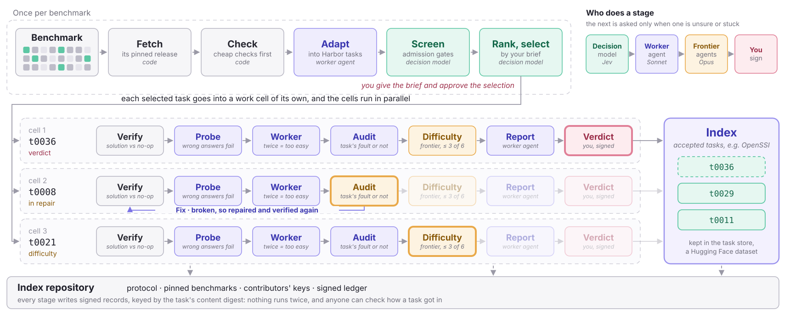
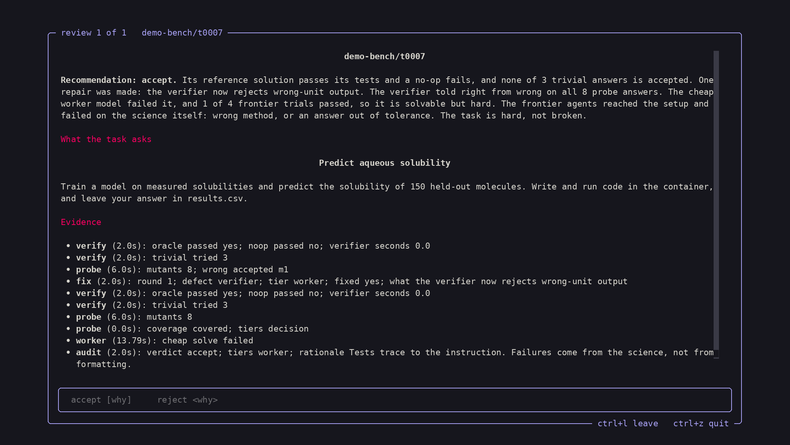
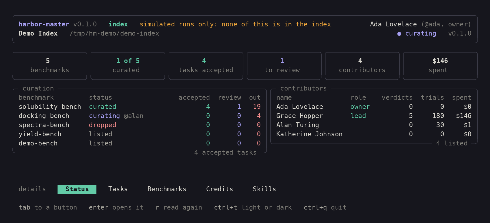

<h1 align="center">Harbor-Master</h1>

<p align="center">
  <strong>Harbor-Master</strong> curates benchmarks into an <strong>index</strong>: tasks that are sound, verifiable, and still too hard for frontier agents. It checks each task in stages ordered by cost, repairs what is broken, and hands a person a report to sign. Every decision, trial and verdict goes into a <strong>signed ledger</strong>, so nothing runs twice and anyone can check how a task got in.
</p>

<p align="center">
  
</p>

## Install

You need Python 3.12+ and [uv](https://docs.astral.sh/uv/).

```bash
uv tool install git+https://github.com/Open-SSI/harbor-master
hm init                          # who you are, and your signing key
```

Try it on a made-up index, with no keys and no Docker:

```bash
hm clone demo-index && cd demo-index
hm curate --demo                 # curate a made-up benchmark, simulated
hm view --demo                   # the dashboard
```

## Contribute to an index

```bash
hm indexes                       # the listed indexes
hm clone INDEX && cd INDEX
hm curate
```

Send the owner the line `hm init` printed, so they can add you. Put your keys in the clone's `secrets.env` (git ignores it): a Claude and an OpenAI key or subscription, an OpenRouter key, and your own `HF_TOKEN`. Before anything is spent, `hm curate` checks each key and model, Docker, and that each agent of the difficulty suite runs a command in a container.

## The curate screen

<p align="center">
  
</p>

Type a listed benchmark's name, or paste any link to a new one: an agent finds its repository and release, and you check the draft once. You type in three places; every other box is one `enter`.

| You type | You confirm |
|---|---|
| A **brief**: what matters in the benchmark | A new benchmark's draft, and its checks |
| The **selection**: how many ranked tasks go on | How many work cells run at once |
| A **verdict** on each kept task: `accept`, or `reject <why>` | A benchmark that is rejected, with why |

A trial that hangs is stopped, and a box asks whether to retry it or drop the task. `ctrl+l` leaves (a real run goes on, and `hm curate` shows it again), `ctrl+z` ends the run.

<p align="center">
  
</p>

## Start your own index

Create an empty GitHub repository, and have a Hugging Face token with write access:

```bash
HF_TOKEN=hf_... hm new my-index --tasks my-lab/my-index-tasks --repo my-lab/my-index
```

`--tasks` is the **task store**, a private Hugging Face dataset for the accepted tasks; `--repo` is where the index's files and records are shared.

| To | Do |
|---|---|
| Set it up | Edit `about.toml`, `protocol.toml` and `skills/` |
| Let someone in | `hm contributors add ...` with the line they sent |
| See where it stands | `hm view` |
| Make the final cut | `hm cut TASK why`; `hm restore TASK` undoes it |
| Get it listed | `hm publish` |

<p align="center">
  
</p>

## How curation works

A fast **decision** model takes every gate, a **worker** agent builds, audits and repairs, and **frontier** agents are called only when those are unsure or stuck.

1. **Fetch** the benchmark at its pinned release, **check** it as a whole, and **adapt** it to Harbor format if needed.
2. **Screen** each task: an agent executes work, a program grades it, and no model is reported to solve it more than 40% of the time.
3. **Rank** the tasks under your brief and **select** the top ones (at most 24, and a quarter of the benchmark).
4. **Verify and probe**: nothing is run. The worker agent audits whether the reference solution is valid (one is written if missing) and whether the instruction states everything the tests check. The decision model decides from each audit, the frontier agent audits again when it is unsure, and a person confirms any drop.
5. **Worker and audit**: a task the worker agent solves twice is too easy; a broken one is repaired and checked again.
6. **Difficulty**: two frontier agents try three times each; a task is kept if at most 3 of the 6 pass.
7. **Report**: you accept or reject each kept task.

A benchmark that is rejected, or of which no task is accepted, is dropped after you confirm; anyone may curate it again.

## An index

An index is a git repository; your clone is its folder. Every `hm` command in it pulls first and pushes what is new, and a run claims a whole benchmark, so two people never curate the same one.

| File | Holds |
|---|---|
| `about.toml`, `protocol.toml`, `skills/` | What it is, every setting that can change a result, and what each agent is told |
| `benchmarks.toml`, `contributors.toml` | The benchmarks it may curate, and who may contribute |
| `adapters/` | Code that turns a benchmark into Harbor tasks |
| `ledger/`, `reports/`, `index.toml` | Every signed record, the reports, and the accepted tasks |

## Commands

| Where | Command | Does |
|---|---|---|
| Anywhere | `hm init` | Who you are, and your signing key |
| | `hm indexes`, `hm clone INDEX` | The listed indexes; clone one |
| | `hm new INDEX --tasks ORG/NAME --repo OWNER/NAME` | Start your own |
| In an index | `hm curate` | The curate screen |
| | `hm benchmarks` | The benchmarks and where each stands |
| Owner and leads | `hm view`, `hm cut`, `hm restore` | The dashboard; the final cut |
| Owner | `hm contributors`, `hm publish` | Who may contribute; ask to be listed |

## Development

```bash
git clone https://github.com/Open-SSI/harbor-master && cd harbor-master
uv sync && uv run pytest
uv tool install --editable .     # hm from this checkout
```

[DESIGN.md](DESIGN.md) has the design, the costs, and what is built.

## Citation

```bibtex
@misc{openssi2026harbormaster,
  title={Harbor-Master: Scalable Multi-Agent Infrastructure for Open, Continual Benchmark Indexes},
  author={The OpenSSI Team},
  year={2026}
}
```
